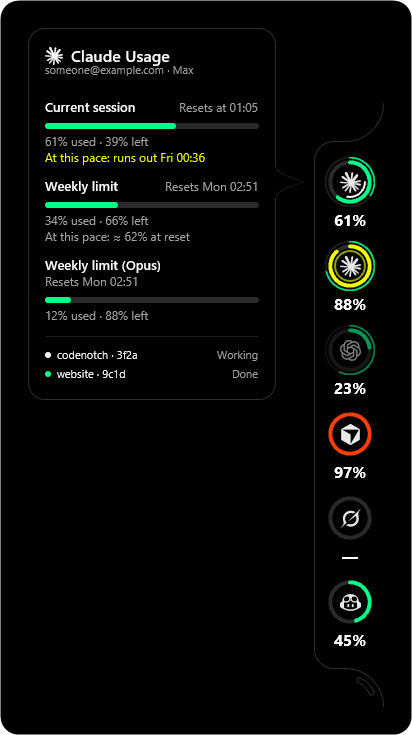
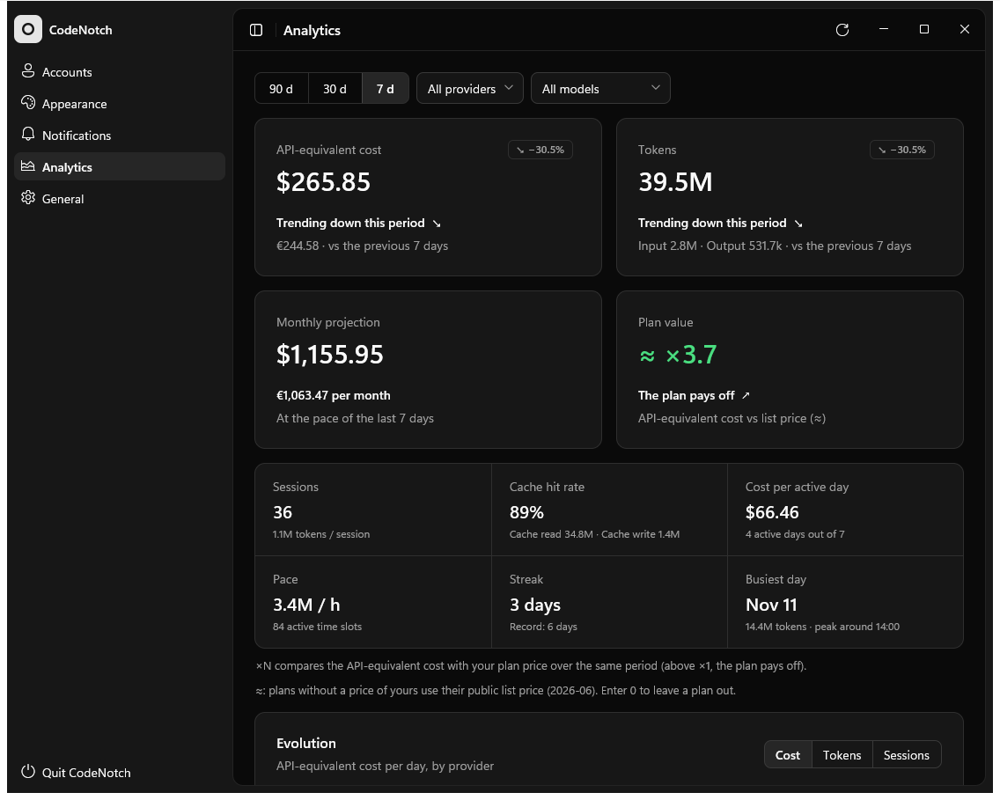
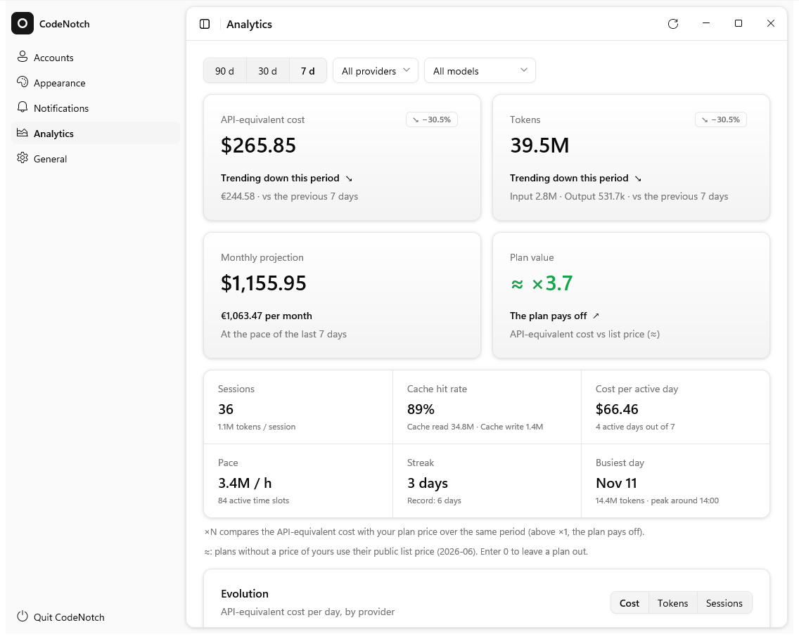
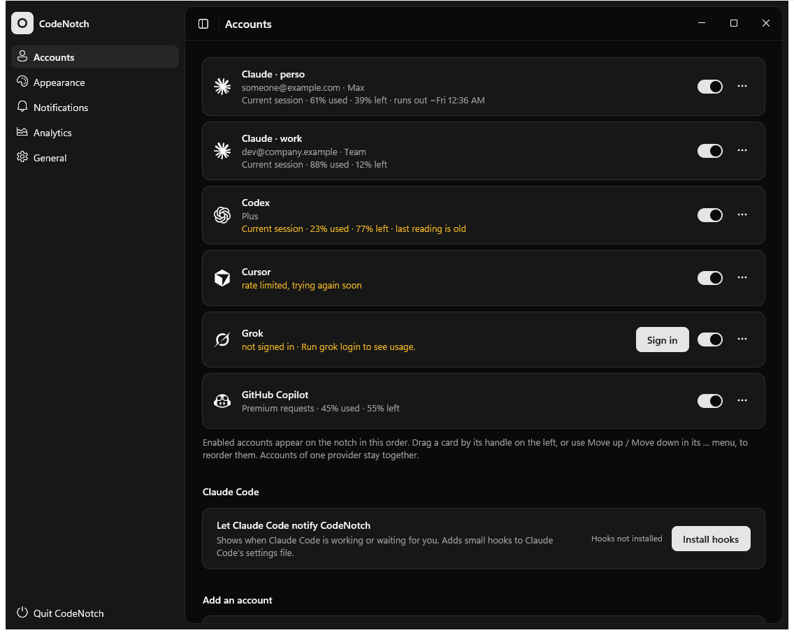
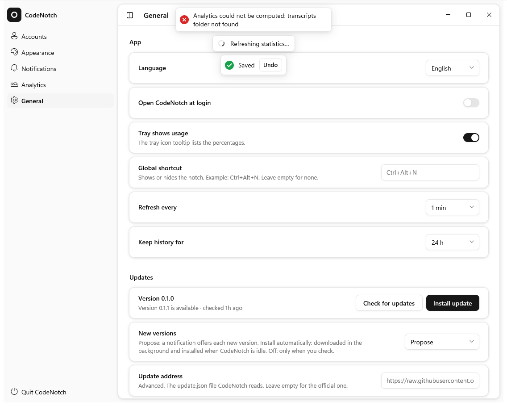
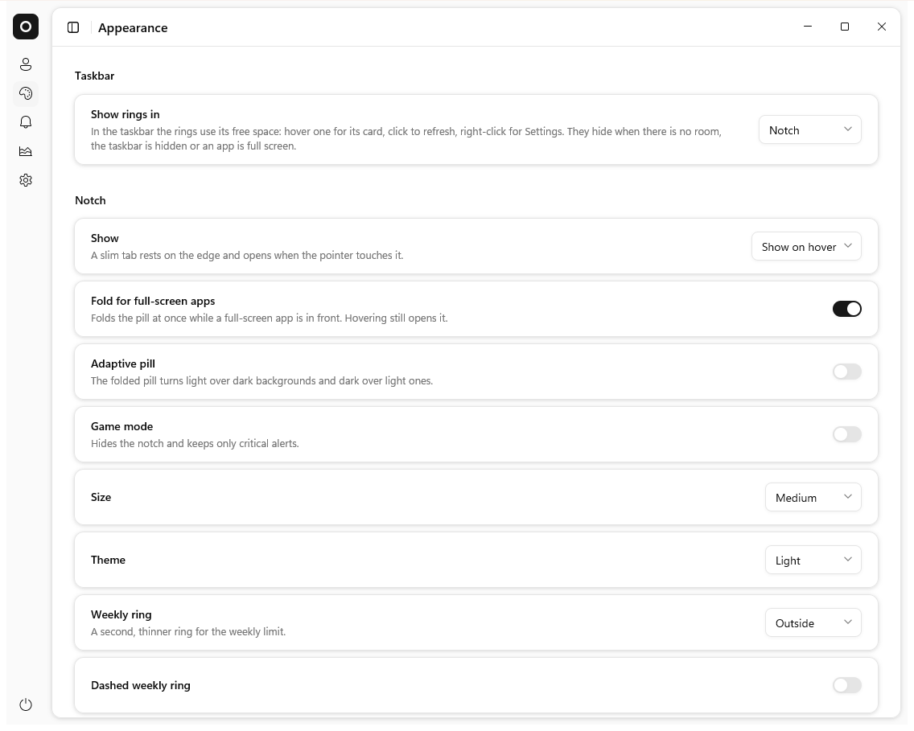
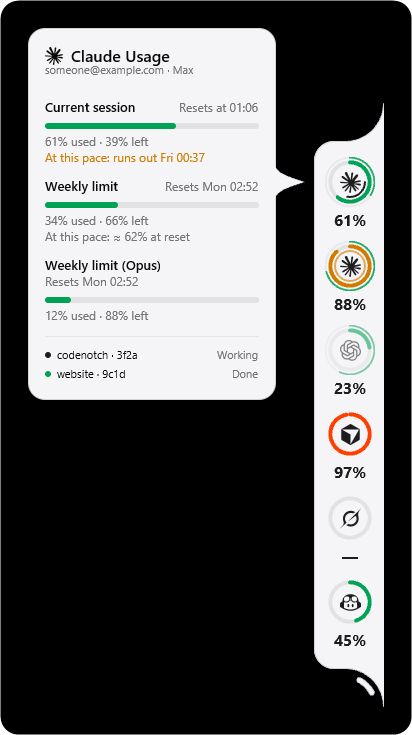

<h1 align="center">CodeNotch for Windows</h1>

<p align="center">
  <strong>Your AI coding quotas at a glance, in a small notch on the edge of the Windows desktop.</strong>
</p>

<p align="center">
  <a href="https://github.com/MakFly/codenotch-windows/actions/workflows/ci.yml"></a>
  <a href="https://github.com/MakFly/codenotch-windows/releases/latest"></a>
  <a href="LICENSE"></a>
  
  
</p>

<p align="center">
  
</p>

CodeNotch draws one ring per AI subscription — Claude, Codex, Grok, Cursor, GitHub Copilot,
OpenCode, Command Code, z.ai (GLM), Antigravity, Qoder or any custom JSON endpoint — and tells you
how much of each quota window is used, when it resets and when it will run out at your current
pace. It is a native Windows app written in Rust with [GPUI](https://crates.io/crates/gpui) 0.2.2:
two small executables, no installer, no runtime, no telemetry.

## Contents

- [Screenshots](#screenshots)
- [Features](#features)
- [Supported providers](#supported-providers)
- [Install](#install)
- [Usage](#usage)
- [Updates](#updates)
- [Configuration](#configuration)
- [Privacy and security](#privacy-and-security)
- [Troubleshooting](#troubleshooting)
- [Development](#development)
- [Releasing](#releasing)
- [Project status](#project-status)
- [Credits and license](#credits-and-license)

## Screenshots

<table>
  <tr>
    <td width="50%"></td>
    <td width="50%"></td>
  </tr>
  <tr>
    <td align="center"><sub>Analytics: cost, tokens and plan value from local transcripts (dark)</sub></td>
    <td align="center"><sub>Same page in the light theme</sub></td>
  </tr>
  <tr>
    <td></td>
    <td></td>
  </tr>
  <tr>
    <td align="center"><sub>Accounts: every provider found on the PC, with its state</sub></td>
    <td align="center"><sub>Toasts and the built-in updater (General page)</sub></td>
  </tr>
  <tr>
    <td></td>
    <td align="center"></td>
  </tr>
  <tr>
    <td align="center"><sub>Appearance, with the sidebar collapsed to its icon rail (Ctrl+B)</sub></td>
    <td align="center"><sub>The notch in the light theme</sub></td>
  </tr>
</table>

<sub>All screenshots come from demo mode (`codenotch.exe --demo`): the figures, names and e-mail
addresses are made up.</sub>

## Features

- **Notch** on the left, right, top or bottom edge of any monitor, one ring cell per account,
  optional second ring for the weekly window, three sizes. Always open, a slim tab that opens on
  hover, or hidden (tray only). Drag it along its edge.
- **Hover card** per account: every quota window, its reset time, the account's status and the
  Claude Code sessions that are working or waiting on you.
- **Forecast** per window: when it will run out at your current pace, or how much will be used at
  the reset. It uses the window's history and, for Claude and Codex, your usual hour-by-hour
  activity, so nights and weekends count for little.
- **Taskbar mode**: the same rings drawn in the free space of the Windows taskbar instead of a
  floating notch.
- **Alerts** when a window crosses the watch or critical threshold, is projected to run out soon,
  or renews — as Windows notifications, on Telegram and on Discord. On-screen reset cards with an
  optional sound.
- **Analytics**: tokens and API-equivalent cost per provider, model, project, day and hour from
  your local Claude Code and Codex transcripts, compared with what your plans cost.
- **Claude Code hooks**: "working" and "waiting on you" states pushed by Claude Code itself;
  busy detection for Codex, Cursor, OpenCode and Antigravity.
- **Settings window** in English and French, light, dark or system theme, first-run onboarding,
  automatic discovery of installed providers.
- **Stays out of the way**: folds while a full-screen app or game is in front, game mode, global
  shortcut, tray menu, open at login without admin rights.
- **Self-update** from a JSON manifest, checksum-verified, with notify, automatic and forced modes.

## Supported providers

Most providers borrow the sign-in that the provider's own tool already holds: sign in with that
tool once and CodeNotch finds it. CodeNotch never writes, refreshes or deletes another tool's
credential files.

| Provider | Sign-in read from | What is shown |
|---|---|---|
| Claude | `~\.claude\.credentials.json` and every `~\.claude-<n>` profile (Claude Code CLI) | Current session, weekly limit, weekly per model, spend limit, extra usage |
| Codex | `~\.codex\auth.json` (Codex CLI) | Current session and weekly limit, Spark and Code review groups |
| Grok | `~\.grok\auth.json` (Grok CLI) | Credits per product |
| Cursor | The Cursor editor's local sign-in (read-only) | Plan usage, API usage, on-demand spend |
| GitHub Copilot | `GH_TOKEN` / `GITHUB_TOKEN`, GitHub CLI | Premium requests and other metered quotas |
| OpenCode | OpenCode's data folder, or a Go API key | OpenCode Go 5-hour, weekly and monthly windows |
| Command Code | `COMMAND_CODE_API_KEY` or `~\.commandcode\auth.json` | Monthly credits, 5-hour and weekly windows |
| z.ai (GLM) | `GLM_API_KEY`, `glm.json`, or Claude Code / ZCode / OpenCode settings | Session, weekly and monthly windows |
| Antigravity | The Antigravity CLI or the IDE's local language server | 5-hour and weekly lanes |
| Qoder | The signed-in `qodercli` session, through the official SDK | Plan usage, add-on credits, organisation package |
| Custom | Any HTTPS endpoint returning JSON windows | The windows the endpoint declares |

<details>
<summary><b>Provider details: exact files, requests and sign-in</b></summary>

For the custom endpoint, GitHub Copilot, OpenCode, Command Code and z.ai, an account can also carry
its own token: from the environment variable named in its `secretEnv`, else from the token stored
for that account in Credential Manager (`CodeNotch/account/<account id>`). In the table, "the
account's token" means that pair. The settings window stores such a token only in the "add a
custom endpoint" form; for the other providers, set `secretEnv` in `config.gpui.json` by hand.

| Provider | Credential read from | Request |
|---|---|---|
| Claude | `<profile>\.credentials.json`, then `<profile>\credentials.json`. Profiles: `~\.claude` and every `~\.claude-<id>` holding a credential, or the account's `profilePath`. | `GET https://api.anthropic.com/api/oauth/usage` |
| Codex | `<profile>\auth.json` (`~\.codex`, or the account's `profilePath`). | `GET https://chatgpt.com/backend-api/wham/usage`. Fallbacks: a hidden `codex.exe app-server`, then the newest rollout file's last rate-limit snapshot. |
| Grok | `~\.grok\auth.json`; only entries issued by `https://auth.x.ai` are ever sent. | `GET https://cli-chat-proxy.grok.com/v1/billing?format=credits` |
| Cursor | `%APPDATA%\Cursor\User\globalStorage\state.vscdb`, opened read-only and re-read on every fetch. | `GET https://cursor.com/api/usage-summary` |
| GitHub Copilot | First found: the account's token, `GH_TOKEN`, `GITHUB_TOKEN`, `oauth_token` in GitHub CLI's `hosts.yml`, then `gh auth token --hostname github.com` run hidden. | `GET https://api.github.com/copilot_internal/user` |
| OpenCode | The account's token (used as a Go API key), else OpenCode's data folder (`$XDG_DATA_HOME\opencode`, then `~\.local\share\opencode`): `auth.json` and `opencode.db`, read-only. | `GET https://opencode.ai/zen/go/v1/usage` (Go API key) or `GET https://opencode.ai/inference/go/v1/usage` (OAuth) |
| Command Code | The account's token, `COMMAND_CODE_API_KEY`, else `apiKey` in `~\.commandcode\auth.json`. | Four `GET`s under `https://api.commandcode.ai/alpha` |
| z.ai (GLM) | First found: the account's token, `GLM_API_KEY`, `glm.json` in the data folder, Claude Code `~\.claude\settings.json` (only when its base URL is a z.ai or bigmodel.cn host), ZCode `~\.zcode\v2\config.json` and plaintext values of `credentials.json`, OpenCode `auth.json`. | `GET {https://api.z.ai or https://open.bigmodel.cn}/api/monitor/usage/quota/limit` |
| Antigravity | No token is read. The official CLI (`%LOCALAPPDATA%\agy\bin\agy.exe`) is run hidden with `/usage`; without it, the IDE's local language server on `https://127.0.0.1:<port>`, then the bundled `~\.gemini\bin\agy.exe`, then today's request count from local transcripts. The CLI runs at most once per 5 minutes. Lanes: settings `antigravityLimit`, `antigravityModel`. | CLI, or loopback only |
| Qoder | The signed-in `qodercli` session, through a Node sidecar that uses the official `@qoder-ai/qoder-agent-sdk`. Qoder Desktop's vault is never touched. | Made by the SDK, not by CodeNotch |
| Custom | The account's token (optional). | `GET <endpoint>` |

**Read-only rule.** SQLite databases are opened read-only. Tokens never go into a reading, the log
or the config file. Two providers may start their own vendor CLI when a token is about to expire,
and that CLI may then renew its own file:

- Claude: when the token expires within 4 minutes, `claude -p` is run hidden (the standalone CLI
  only, not the desktop app's copy), at most every 10 minutes with a growing back-off, killed after
  30 seconds.
- Grok: `grok models` is run hidden.

Codex's `auth.json` is never refreshed. No child process is started at all when
`CODENOTCH_NO_SPAWN=1`.

**Signing in.**

- Claude: the account's sign-in button opens a PowerShell window that runs
  `claude auth login --claudeai` for that profile. "Add a Claude account" creates the next free
  `~\.claude-<n>` folder and signs it in the same way. The standalone Claude Code CLI must be
  installed.
- Other providers: sign in with the provider's own tool (`grok login`, `gh auth login`,
  `opencode auth login`, `qodercli login`, the Cursor editor, the Command Code app). The card shows
  what to run when a provider is signed out.

**Qoder setup.** The sidecar is not installed by the app. Copy
[`crates/providers-extra/assets/qoder-usage.cjs`](crates/providers-extra/assets/qoder-usage.cjs)
into `<data folder>\qoder-sdk\` and install the SDK there (Node.js required):

```powershell
cd "$env:APPDATA\dev.kev.smashtoken\qoder-sdk"
npm install @qoder-ai/qoder-agent-sdk
```

Sidecar search order: `CODENOTCH_QODER_SIDECAR`, `<data folder>\qoder-sdk\`,
`%APPDATA%\codenotch\qoder-sdk\`, next to the exe, `<exe folder>\resources\`. Node.js comes from
`CODENOTCH_QODER_NODE`, else `node.exe` on `PATH`.

**Custom JSON endpoint.** The URL must use HTTPS (plain HTTP only to localhost). The response:

```json
{
  "windows": [
    { "id": "quota", "label": "Monthly quota", "usedPercent": 42,
      "resetsAt": "2026-11-01T00:00:00Z", "windowSeconds": 2592000 }
  ]
}
```

- Used share: `usedPercent`, `used_percent` or `utilization` (a value up to 1 is read as a
  fraction), or `used` with `limit`.
- Reset: `resetsAt`, `resets_at`, `reset_at` or `resetAt`, as RFC 3339, unix seconds or
  milliseconds.
- Optional: `id` (default: derived from the label), `label` or `name`, `windowSeconds`, `count`,
  `detail`, `group`.
- A top-level array of windows is accepted too. A body without any usable window is an error.

The bearer token is optional. It comes from the environment variable named in the account's
`secretEnv`, else from the token typed in the "add a custom endpoint" form (stored in Credential
Manager). When `secretEnv` names a variable that is not set and nothing is stored, the reading is
an error that names the variable.

</details>

## Install

**Requirements:** Windows 10 or 11 (x64). Each provider needs its own tool installed and signed in.

1. Download `CodeNotch-<version>.zip` from the
   [latest release](https://github.com/MakFly/codenotch-windows/releases/latest). Its SHA-256 is
   published next to it.
2. Unzip it anywhere you like, for example `%LOCALAPPDATA%\Programs\CodeNotch`.
3. Run `codenotch.exe`. On the first start the onboarding opens and the providers found on the PC
   are added as accounts.

Keep `codenotch-hook.exe` in the same folder as `codenotch.exe`: the app looks for it there. The
binaries are not code-signed, so Windows SmartScreen may ask for confirmation the first time.

**From source**, with Rust (MSVC toolchain) and [GNU Make for Windows](#development):

```powershell
git clone https://github.com/MakFly/codenotch-windows
cd codenotch-windows
make install    # release build, copied to %LOCALAPPDATA%\Programs\CodeNotch
```

`make install` creates no shortcut, registry or autostart entry; turn on "Open CodeNotch at login"
in the settings for that. `make uninstall` removes the executables again (not your data).

## Usage

- **Notch**: hover the tab on the screen edge to open it, hover a ring for its card, click a ring to
  refresh it, right-click a ring for its menu, drag the notch along its edge.
- **Taskbar strip** (Settings → Appearance → Taskbar): the same rings in the free space of the
  taskbar. Hover for the card, click to refresh, right-click for the settings.
- **Tray icon**: "Refresh all", "Settings…", "Game mode" and "Quit CodeNotch". Its tooltip can list
  the percentages.
- **Settings window**: Accounts, Appearance, Notifications, Analytics and General pages. Ctrl+B
  collapses the sidebar to an icon rail.
- **Global shortcut** (Settings → General, for example `Ctrl+Alt+N`): show or hide the notch.
- A second launch does not start a second app: it brings the running one's settings to the front.

### Command line

```text
codenotch [--settings | --settings-page=<page> | --demo [--theme=<mode>] | --once | doctor | --version]
```

| Argument | What it does |
|---|---|
| (none) | Start the notch. |
| `--silent` | Same as no argument. This is what "Open at login" registers. |
| `--settings` | Start and open the settings window. |
| `--settings-page=<page>` | Open the settings on `accounts`, `appearance`, `notifications`, `analytics` or `general`. |
| `--demo` | GUI on made-up figures for the providers found on this PC. No engine, no network, no single-instance lock. `--theme=light\|dark\|system` forces the theme. |
| `--once` | Fetch every enabled account once, print one line each, exit. Writes nothing. |
| `doctor` (or `--doctor`) | Print what the app sees on this machine (presence only, never a secret), exit. |
| `--version` (or `-V`) | Print `codenotch 0.1.0`, exit. |
| `--help` (or `-h`) | Print the version and the usage, exit. |
| `--updated-from=<version>`, `--wait-pid=<pid>` | Set by the self-updater when it restarts the app. Not for manual use. |

If several are given, the first match in this order wins: version, help, doctor, once, demo,
settings. Release builds have no console window; the CLI modes attach to the console they were
started from.

<details>
<summary><b>More about <code>--once</code> and <code>doctor</code></b></summary>

`--once` prints one line per enabled account:

```text
<account name> (<provider>): <window> <percent> (<reset countdown>) · <window> <percent> ...
```

When a reading has no figures, the line carries the provider's note or error instead. A stale
reading gets its age in brackets at the end. With no enabled account it prints `no enabled
account`. Tokens are never printed; messages go through the same redaction as the log. It also
runs provider discovery (the result is not saved), fetches in parallel and stops after 130 seconds
at most. It can start helper programs (for example `codex.exe app-server`, `gh auth token`, the
Antigravity CLI); set `CODENOTCH_NO_SPAWN=1` to prevent that.

`doctor` is read-only. It creates nothing and prints presence only: version and executable path;
data folder; `config.gpui.json` status, accounts, language, refresh period, onboarding;
`state.json`, history samples, log path; each provider (detected or not, configured accounts);
each account (profile folder, credential file, endpoint host, token variable, stored token, last
reading, back-off); Telegram and Discord secrets present or absent; hook helper, hooks installed,
hook port and token file; open at login and the global shortcut.

</details>

### Alerts

All alerts follow the `notifications` switch (Settings → Notifications → Desktop notifications),
except reset cards, which follow `resetCards` alone.

- **Threshold alerts**: a window crosses the watch threshold (`alertPercent`, default 80) or the
  critical threshold (`criticalPercent`, default 95) upward between two fresh readings. One alert
  per window, kind and reset period, remembered across restarts.
- **Forecast alerts** (`forecastAlerts`): the last hour of history projects the window to run out
  within `forecastMinutes` (default 30) and before its own reset.
- **Reset alerts** (`resetAlerts`) and **reset cards** (`resetCards`, `resetSound`) when a window
  renews.
- While a full-screen app or game is in front (or `gameMode` is on), on-screen output is held back,
  except critical alerts when `criticalInFullscreen` is on. Telegram and Discord are not affected.

**Telegram and Discord.** Settings → Notifications has a section for each, with a test button.
The bot token and the webhook URL are stored in Windows Credential Manager
(`CodeNotch/telegram-token`, `CodeNotch/discord-webhook`), or read from `CODENOTCH_TELEGRAM_TOKEN`
and `CODENOTCH_DISCORD_WEBHOOK` (a variable wins). The Telegram chat id is stored in the config
(`telegramChatId`) and hidden from logs. Accepted formats: bot token
`<digits>:<at least 20 letters, digits, _ or ->`; chat id a number (negative for groups) or
`@channelname`; webhook `https://discord.com/api/webhooks/<id>/<token>` (also `discordapp.com`,
`ptb.discord.com`, `canary.discord.com`, an optional `/vN` after `/api`). Each request has an
8-second timeout and one retry on a transient failure.

### Claude Code hooks

Hooks let Claude Code tell CodeNotch when a session is working or waiting for you. Install them in
Settings → Accounts → Claude Code → "Install hooks". Without hooks, activity is still guessed from
the transcript files.

<details>
<summary><b>What the installer changes, and how the hooks work</b></summary>

Installing:

- works on every Claude Code profile folder that exists: `~\.claude`, every `~\.claude-*`,
  `CLAUDE_CONFIG_DIR`, and the profile folder of any Claude account set in the config;
- merges entries into that folder's `settings.json` (created if missing) for the events
  `SessionStart`, `UserPromptSubmit`, `PreToolUse` (matcher `*`), `PostToolUse` (matcher `*`),
  `Notification`, `Stop` and `SessionEnd`. Each entry runs
  `"<folder of codenotch.exe>\codenotch-hook.exe" <event>` with a 5-second timeout;
- keeps everything else exactly as it was, including other tools' hooks on the same events;
- is idempotent, writes atomically and, the first time it changes an existing file, keeps a copy
  as `settings.json.codenotch.bak` (never overwritten afterwards);
- never writes a file that is not valid JSON or whose `hooks` has an unexpected shape;
- fails with a notice when `codenotch-hook.exe` is not next to `codenotch.exe`.

Removing ("Remove hooks") deletes only commands containing `codenotch-hook` (or the legacy names
`eatbean-hook`, `pacman-hook`). A matcher group, an event or the `hooks` object is removed only
when that removal emptied it.

The hook server listens on `127.0.0.1:<hookPort>` (default 48666) while `hooksEnabled` is on.
`codenotch-hook.exe` reads the hook's JSON from stdin (at most 256 KiB), the port from
`config.gpui.json` and the token from `auth_token`, then posts the event with a 300 ms connect and
700 ms I/O timeout. It never prints, always exits 0 and does not start CodeNotch when nothing
listens.

</details>

### Analytics

Settings → Analytics covers `analyticsDays` days (default 7): tokens and cost per provider, model,
project, day and hour, in USD and EUR (`usdToEur`), compared with plan prices (`planPricesEur`).
The sources are read-only: Claude Code's `<profile>\projects\**\*.jsonl` and Codex's
`<profile>\sessions\**\rollout-*.jsonl` (and `archived_sessions`). Only usage numbers, model ids,
working directories and timestamps are read, never message content. The index in
`analytics-cache.json` is incremental and refreshed 10 seconds after start, every 15 minutes and on
"Refresh".

Built-in prices cover Anthropic Claude models and the OpenAI GPT-5 family. A model without a price
is never priced at 0: its tokens are counted as unpriced and the totals are shown as a lower bound.
Add or override prices in [`pricing.json`](#pricingjson).

### Taskbar mode

Settings → Appearance → Taskbar → "Show rings in": Notch, Taskbar left or Taskbar right
(`taskbarMode`: `off`, `left`, `right`). The floating notch is then hidden and the cells are drawn
over the free space of the primary taskbar. The strip hides when there is no room, the taskbar is
hidden or an app is full screen.

Limits: only the primary, horizontal, left-to-right taskbar at the bottom or top of the primary
monitor; vertical, secondary and third-party taskbars are not supported. The free space is
measured with UI Automation — nothing is injected into Explorer — and Explorer's layout is not a
public API, so a future Windows build may break the measurement; the strip then hides after
6 seconds.

## Updates

CodeNotch updates itself from a small JSON **manifest**. By default it reads
[`update.json`](update.json) at the root of this repository
(`https://raw.githubusercontent.com/MakFly/codenotch-windows/main/update.json`); Settings →
General → "Update address" (`updateManifestUrl`) points it elsewhere.

It checks about 20 seconds after start, then every 6 hours, unless `updateMode` is `off`. "Check
for updates" in Settings → General checks at once in every mode.

| Mode (`updateMode`) | With a newer version |
|---|---|
| `notify` (default) | A toast "CodeNotch 0.2.0 is available" with **Update** and **Notes** (once per version and session), plus a Windows notification. **Update** downloads, installs and restarts. |
| `auto` | Downloaded in the background and installed when CodeNotch is idle (no Claude Code or Codex session working, settings window not in use), or at the next start. |
| `off` | No automatic check; the button still works. |

**Forced updates.** A running version below the manifest's `min_version` is a required update:
downloaded and installed at once, in every mode, under a toast that cannot be dismissed.

<details>
<summary><b>How an update is installed</b></summary>

1. The zip is downloaded to `<data folder>\updates\<version>\` (https only; redirects never to a
   non-https address). Its size and SHA-256 must match the manifest, or it is deleted and the
   update fails.
2. `codenotch.exe` and `codenotch-hook.exe` are unpacked from it by file name (paths inside the zip
   are ignored); nothing else is kept, and nothing is run.
3. Windows cannot overwrite a running exe but can rename it: each installed exe is renamed
   `<name>.old` and the new one moved into the install folder (the folder of the running
   `codenotch.exe`). A rename is retried for 2 seconds. Any failure puts the old files back.
4. The new `codenotch.exe` is started with `--updated-from=<old version> --wait-pid=<old pid>`; it
   waits for the old process to exit, deletes the `.old` files and the package, and shows "Updated
   to …". If it cannot be started, the old files are put back. If a restart does not run the
   expected version, that version is reported and never installed automatically again.

The toasts appear in the settings window when it is open, otherwise in a small click-through
window at the top centre of the notch's screen. An exe running from a cargo `target\` folder never
updates itself; `CODENOTCH_UPDATE_ALLOW_DEV=1` allows it.

</details>

### Manifest format

```json
{
  "version": "0.2.0",
  "min_version": "0.1.0",
  "published_at": "2026-12-01",
  "notes": "Short release notes.",
  "notes_url": "https://github.com/MakFly/codenotch-windows/releases/tag/v0.2.0",
  "windows_x64": {
    "url": "https://github.com/MakFly/codenotch-windows/releases/download/v0.2.0/CodeNotch-0.2.0.zip",
    "sha256": "<64 hex digits: SHA-256 of the zip>",
    "size": 12345678
  }
}
```

| Field | Meaning |
|---|---|
| `version` | Latest version, semantic versioning (a leading `v` is accepted), compared with strict semver precedence: `1.1.0-rc.1` < `1.1.0` < `1.10.0`. Required. |
| `min_version` | Optional. A running version below it updates without asking. |
| `published_at`, `notes` | Optional, informational. |
| `notes_url` | Optional release page for the **Notes** button (https only). |
| `windows_x64` | The package, as `make dist` builds it: a zip holding `codenotch.exe` (required) and `codenotch-hook.exe`. `url` (https), `sha256` (hex), `size` (exact bytes). Needed only when `version` is newer than the running one. |

One file per channel; unknown fields are ignored.

<details>
<summary><b>Testing an update locally</b></summary>

`CODENOTCH_UPDATE_URL` overrides the manifest address and also accepts `file:///C:/…/update.json`
or a plain path (local files are otherwise accepted only by debug builds), with a `file:///` zip URL
inside. In a debug build, `CODENOTCH_UPDATE_PRETEND_VERSION=0.0.9` makes the updater believe it
runs 0.0.9 (not passed to the restarted exe). With `--demo`, the updater runs only when
`CODENOTCH_UPDATE_URL` is set.

A dry run: copy `codenotch.exe` and `codenotch-hook.exe` to a scratch folder, zip a second copy as
`CodeNotch-0.1.0/…`, write a manifest with its SHA-256 and size (add `"min_version": "0.1.0"` to
make it install without a click), then start the copy with `CODENOTCH_DATA_DIR`,
`CODENOTCH_UPDATE_URL`, `CODENOTCH_UPDATE_PRETEND_VERSION=0.0.9` and `--demo`.

</details>

## Configuration

Everything is set from the settings window. The files below are for reference, scripting and
troubleshooting.

### Where data lives

The data folder is `%APPDATA%\dev.kev.smashtoken` (the folder earlier versions already used).
`CODENOTCH_DATA_DIR` replaces it when set and not empty.

| File | Written by | What it holds |
|---|---|---|
| `config.gpui.json` | app | Accounts and settings. Saved atomically. Unknown keys are kept. |
| `config.gpui.unreadable.json` | app | A copy of `config.gpui.json` made when it cannot be parsed; the app then starts on defaults. |
| `state.json` | app | Last reading per account, rate-limit back-off deadlines, alert bookkeeping. |
| `history.jsonl` | app | One line per quota window per fresh reading: `{"a":"<account id>","l":"<window label>","t":<unix secs>,"u":<percent used>,"r":<reset time or null>}`. Pruned to `historyHours`, except samples of a window whose period has not ended yet (kept up to 32 days, thinned to one per 10 minutes) so weekly and monthly forecasts see their whole period. |
| `analytics-cache.json` | app | Incremental index of the transcripts: per file, bytes read, model, working directory, hourly token counts. No message content. |
| `auth_token` | app | The hook server token (64 hex characters). |
| `logs\codenotch.log` | app | The log, rotated at 1 MiB to `codenotch.1.log` … `codenotch.3.log`. |
| `updates\` | app | Downloaded update packages, removed after a successful update. |
| `pricing.json` | you (optional) | Model price overrides for analytics. |
| `glm.json` | you (optional) | A z.ai key file. |
| `glyphs\<provider id>.svg` or `.png` | you (optional) | Replaces the built-in provider mark. |
| `qoder-sdk\` | you (optional) | The Qoder sidecar and its Node SDK. |

For `glm.json` and `qoder-sdk\`, the older folder `%APPDATA%\codenotch\` is also searched.
`config.gpui.json` and `history.jsonl` files from the 0.2.x and 0.3.0 apps keep working: every key
keeps its name and meaning, unknown keys survive a save, and a bad value for a choice setting falls
back to its default instead of failing the whole file.

Outside the data folder, the app writes only:

- Windows Credential Manager generic credentials `CodeNotch/telegram-token`,
  `CodeNotch/discord-webhook` and `CodeNotch/account/<account id>`, when you save a secret;
- `HKCU\Software\Microsoft\Windows\CurrentVersion\Run`, value `CodeNotch` = `"<exe>" --silent`,
  when "Open CodeNotch at login" is on (turning it on also clears a "disabled" flag Task Manager
  may have set under `…\Explorer\StartupApproved\Run`);
- `HKCU\Software\Classes\AppUserModelId\dev.kev.CodeNotch`, so Windows accepts the app's
  notifications;
- Claude Code's `settings.json`, only when you install or remove the [hooks](#claude-code-hooks);
- `~\.claude-<n>\`, only when you use "Add a Claude account" (removed again if the sign-in does not
  leave a credential).

### Settings reference

All settings live under `settings` in `config.gpui.json`. Keys are camelCase.

<details>
<summary><b>Keys from 0.2 and 0.3 (names frozen)</b></summary>

| Key | Meaning | Default |
|---|---|---|
| `language` | UI language: `en` or `fr`. `auto`, `system` or empty follow the Windows UI language. Anything else falls back to English. | `"en"` |
| `theme` | `system`, `light` or `dark`. Applies to the notch, its cards, the reset cards and the settings window. | `"system"` |
| `pollSeconds` | Automatic refresh period in seconds, clamped to 30–300. | `60` |
| `notifications` | Master switch for threshold, forecast and reset alerts. | `true` |
| `alertPercent` | Watch threshold in percent used (also the "watch" colour), clamped to 1–99. | `80` |
| `widget` | Legacy "show the notch". `false` means hidden when `showMode` is absent. | `true` |
| `widgetPosition` | Screen edge: `left`, `right`, `top`, `bottom`. | `"right"` |
| `autoHide` | Legacy 0.3 "expand on hover". Kept for round trip; not used. | `true` |
| `hideInFullscreen` | Legacy 0.3 "hide in full screen". Kept for round trip; `foldForFullScreen` is used instead. | `true` |
| `gameMode` | Hide everything and stop non-critical alerts. | `false` |
| `widgetPlacement` | `{ "monitor": "<device name, empty = primary>", "x": 1.0, "y": 0.5 }`. `y` is the position along the edge, 0–1. `x` is legacy and not used. | `{"monitor":"","x":1.0,"y":0.5}` |
| `onboardingDone` | Whether the first-run onboarding was finished. Absent: existing accounts count as onboarded. | absent |
| `criticalPercent` | Critical threshold in percent used, clamped to (watch + 1)–100. | `95` |
| `forecastAlerts` | Forecast alerts on or off. | `true` |
| `forecastMinutes` | Forecast lead time in minutes. | `30` |
| `resetAlerts` | Desktop notification when a window resets. | `true` |
| `criticalInFullscreen` | Let critical alerts through while a full-screen app is in front. | `true` |
| `telegramEnabled` | Send alerts to Telegram. | `false` |
| `telegramChatId` | Telegram chat id (the bot token is not stored here). | `""` |
| `discordEnabled` | Send alerts to Discord. | `false` |
| `launchAtStartup` | Open CodeNotch at login. | `false` |
| `trayShowsUsage` | Tray tooltip lists the percentages. | `true` |
| `hotkey` | Global shortcut, for example `"Ctrl+Alt+N"`. `null` = none. | `null` |
| `historyHours` | Hours of history kept in `history.jsonl`. | `24` |
| `analyticsDays` | Analytics period in days. | `7` |
| `usdToEur` | Conversion rate for costs in EUR. | `0.92` |
| `planPricesEur` | Plan prices in EUR per month. Keys: `"<Provider> <plan>"` (`"Claude Max"`) or the provider name alone. Values: a number or a numeric string. Readers also accept an account id, account name, bare plan name or provider id. | `{}` |

</details>

<details>
<summary><b>Keys added in 0.1.0 (all optional)</b></summary>

| Key | Meaning | Default |
|---|---|---|
| `notchSize` | `small` (0.8×), `medium` (1.0×), `large` (1.25×). | `"medium"` |
| `showMode` | `always`, `hover` (folded tab until hovered) or `hidden` (no pill; the tray icon stays and reset cards still appear). Absent (0.3 file): `hover`, or `hidden` when `widget` is `false`. | `"hover"` on a fresh install |
| `foldForFullScreen` | Fold the pill while a full-screen app is in front of its monitor. | `true` |
| `adaptivePill` | The folded pill turns dark or light from the brightness behind it. | `false` |
| `notchAlwaysDark` | Legacy "notch always dark". Kept for round trip; ignored: the notch and its cards follow `theme`. | `true` |
| `weeklyRing` | Second ring for the weekly window: `off`, `inside`, `outside`. | `"off"` |
| `weeklyRingDashed` | Draw the weekly ring dashed. | `false` |
| `showRemaining` | Show remaining instead of used (the colour still grades the used share). | `false` |
| `showUsagePace` | Show the usage pace figure on the card. | `false` |
| `showForecast` | Show the exhaustion forecast on the card and the Accounts page. | `true` |
| `colorTransition` | Ring colour change: `hard_step` or `ramp`. | `"hard_step"` |
| `taskbarMode` | `off`, `left`, `right` (see [Taskbar mode](#taskbar-mode)). | `"off"` |
| `resetCards` | On-screen card when a window renews. | `true` |
| `resetSound` | Play the system sound with the reset card. | `true` |
| `providerOrder` | Provider ids in display order, completed with the default order. Empty = default. | `[]` |
| `hiddenAccounts` | Account ids that are fetched but not drawn on the notch. | `[]` |
| `removedAccounts` | Detected accounts you removed (`provider`, `profilePath`, `name`), so discovery does not add them back. "Removed accounts" in the settings adds one again. | `[]` |
| `hooksEnabled` | Claude Code hooks installed; the hook server runs while on. | `false` |
| `hookPort` | Hook server port on 127.0.0.1. | `48666` |
| `updateMode` | `notify`, `auto` or `off` (see [Updates](#updates)). Absent (older file): `off` when `updateChecks` is `false`, else `notify`. | `"notify"` |
| `updateManifestUrl` | Update manifest address (https). Absent or empty: the official `update.json`. | absent |
| `updateChecks` | Legacy switch, superseded by `updateMode` and kept in sync with it (`false` exactly when the mode is `off`). | `true` |
| `antigravityLimit` | Antigravity lane: `automatic`, `5h`, `weekly`. | `"automatic"` |
| `antigravityModel` | Antigravity model family: `gemini` or `3p` (Claude and GPT models). | `"gemini"` |
| `settingsSidebarCollapsed` | Settings window: sidebar collapsed to its icon rail (toggle button or Ctrl+B). A window narrower than 900 px shows the rail without changing this key. | `false` |

Default provider order: `claude`, `codex`, `glm`, `opencode`, `commandcode`, `cursor`, `grok`,
`copilot`, `antigravity`, `qoder`, `custom`.

</details>

<details>
<summary><b>Account keys</b></summary>

Each entry of `accounts`:

| Key | Meaning |
|---|---|
| `id` | Stable unique id. |
| `name` | Name shown to you. |
| `provider` | `claude`, `codex`, `glm`, `opencode`, `commandcode`, `cursor`, `grok`, `copilot`, `antigravity`, `qoder`, `custom`. `gemini` is read as Antigravity, `zai` and `z.ai` as GLM. An unknown value is kept as it is. |
| `enabled` | Disabled accounts are neither fetched nor shown. |
| `profilePath` | The provider's profile folder. Empty = the provider's default folder. |
| `endpoint` | Custom JSON endpoint URL. Any account with an endpoint is read as a custom endpoint. |
| `secretEnv` | The **name** of an environment variable holding the token, never the token itself. |
| `hasSecret` | Informational flag. |

</details>

### pricing.json

Add or override model prices in `<data folder>\pricing.json`:

```json
{
  "models": {
    "gpt-6-luna":      { "input": 1.25, "output": 10.0, "cacheRead": 0.125, "cacheWrite": 1.25 },
    "claude-opus-5-5": { "input": 4.0, "output": 20.0, "cacheRead": 0.2, "cacheWrite": 5.0, "cacheWrite1h": 8.0 },
    "claude-opus-4-1": null
  }
}
```

- Keys are model ids, normalised like transcript ids (lower case; prefixes such as `anthropic.` or
  `openai/`, date suffixes such as `-20250514` or `@20250514`, Bedrock `-v1:0` and `[1m]` tags
  removed), then matched exactly: `gpt-5` never prices `gpt-5-pro`.
- Every rate is USD per million tokens. `input`, `output`, `cacheRead` and `cacheWrite` (5-minute
  cache writes) are required; `cacheWrite1h` is optional and defaults to `cacheWrite`. The
  snake_case spellings `cache_read`, `cache_write`, `cache_write_1h` are accepted too.
- An entry missing a required rate is ignored (and logged). `null` removes a built-in price. An
  unreadable file is ignored (and logged).

### Environment variables

<details>
<summary><b>Every variable the app reads</b></summary>

| Variable | Effect |
|---|---|
| `CODENOTCH_DATA_DIR` | Use this folder instead of `%APPDATA%\dev.kev.smashtoken`. Also gives the instance lock its own name, so a test copy can run beside the installed one. Read by `codenotch-hook.exe` too. |
| `CODENOTCH_NO_SPAWN` | `1` = start no child process: no Claude/Grok renewal, no sign-in window, no `codex.exe app-server`, no `gh`, no Antigravity CLI, no Qoder sidecar, no PowerShell or `netstat` probes. |
| `CODENOTCH_NOTCH_NO_REGION` | Any value other than `0`: the notch window is not clipped to its visible shapes. For diagnosing the notch window. |
| `CODENOTCH_TELEGRAM_TOKEN` | Telegram bot token. Wins over Credential Manager. |
| `CODENOTCH_DISCORD_WEBHOOK` | Discord webhook URL. Wins over Credential Manager. |
| `CODENOTCH_QODER_SIDECAR` | Path of `qoder-usage.cjs`, searched first. |
| `CODENOTCH_QODER_NODE` | Path of `node.exe` for the Qoder sidecar. |
| `CODENOTCH_UPDATE_URL` | Update manifest address, instead of the setting. Also accepts `file://` URLs and paths. With `--demo`, starts the updater. |
| `CODENOTCH_UPDATE_ALLOW_DEV` | `1` = allow self-update of an exe running from a cargo `target\` folder. |
| `CODENOTCH_UPDATE_PRETEND_VERSION` | Debug builds only: the version the updater compares with (dry runs). |
| `CLAUDE_CONFIG_DIR` | An extra Claude Code profile folder for the hooks installer, and the default Claude folder for analytics. |
| `CODEX_HOME` | The Codex folder for analytics and activity, instead of `~\.codex`. |
| `XDG_DATA_HOME` | OpenCode's data folder parent. |
| `GH_CONFIG_DIR`, `XDG_CONFIG_HOME` | Where GitHub CLI's `hosts.yml` is looked for. |
| `GH_TOKEN`, `GITHUB_TOKEN` | GitHub token for Copilot. |
| `GLM_API_KEY` | z.ai key. |
| `COMMAND_CODE_API_KEY` | Command Code key. |
| `HTTPS_PROXY`, `HTTP_PROXY` (and lower-case), `NO_PROXY` | Proxy. When none is set, the app copies the Windows (WinINet) proxy into them at start, and sets `NO_PROXY` to loopback plus the Windows bypass list. |
| any name in an account's `secretEnv` | That account's token. |

`PATH`, `ProgramFiles`, `ProgramFiles(x86)` and `SystemRoot` are read to find provider CLIs and
system tools. `CODENOTCH_CLAUDE_CLI` is set by the app for its own sign-in window; it is not an
input.

</details>

## Privacy and security

**Read locally, never uploaded:** your providers' sign-in files (read-only), Claude Code and Codex
transcripts (usage numbers, model ids, working directories and timestamps only — never message
content), and the app's own history, state and analytics index.

**Sent over the network:**

- to each provider's own usage endpoint, with that provider's credential only: `api.anthropic.com`,
  `chatgpt.com`, `cli-chat-proxy.grok.com`, `cursor.com`, `api.github.com`, `opencode.ai`,
  `api.commandcode.ai`, `api.z.ai` or `open.bigmodel.cn`, and your custom endpoint. Antigravity is
  read through its CLI or a loopback address; the Qoder SDK makes its own requests;
- alerts to `api.telegram.org` and your Discord webhook, only when you turn them on;
- the update manifest (`raw.githubusercontent.com` by default) and, when you update, the package
  from the address it gives (GitHub release assets by default).

There is no telemetry, analytics beacon or crash reporting.

<details>
<summary><b>Security details</b></summary>

- **Hook server**: bound to `127.0.0.1` only. It accepts only `POST /event` with the token from
  `auth_token` (compared in constant time), rejects non-loopback `Host` and `Origin` headers and
  cross-site browser requests, and caps headers at 16 KiB and bodies at 256 KiB.
- **Secrets** (Telegram token, Discord webhook, account tokens) are kept in Windows Credential
  Manager or read from environment variables. They are never written to `config.gpui.json`,
  `state.json`, history, snapshots or logs, and their `Debug` output is `***`. The config stores
  only the name of a token's environment variable. The Telegram chat id is the exception: it is
  stored in the config, and hidden from debug output and logs.
- **Logs** are redacted before writing (bearer tokens, `token=` style values, Telegram bot tokens,
  long letter-and-digit runs). `doctor` prints presence only.
- **Child processes** (provider CLIs, `gh`, PowerShell, `netstat`, Node) run hidden, with a
  timeout, and not at all with `CODENOTCH_NO_SPAWN=1`.
- **Updates** are accepted only over https and only when the package's size and SHA-256 match the
  manifest. The binaries are not code-signed.
- **Links** opened from the app must be `http` or `https`. "Open data folder" shows a folder and
  never runs a file.
- Grok sessions are sent only when issued by `https://auth.x.ai`. The Antigravity loopback client
  accepts a self-signed certificate for `127.0.0.1` only.

</details>

## Troubleshooting

- **Log**: `<data folder>\logs\codenotch.log` (`make logs` shows its end). Debug builds log at
  debug level, release builds at info level.
- **What does the app see?** Run `codenotch.exe doctor`. It is read-only and prints no secrets.
- **Readings without side effects**: `$env:CODENOTCH_NO_SPAWN = "1"; codenotch.exe --once`.
- **Try with a clean data folder**: set `CODENOTCH_DATA_DIR` to an empty folder.
- **Notch drawing or mouse problems**: start with `CODENOTCH_NOTCH_NO_REGION=1` to see whether
  the window region is involved.
- **Build fails with "Access is denied (os error 5)"**: a running `codenotch.exe` locks its file.
  Quit it from the tray or run `make stop`.
- **"codenotch-hook.exe was not found" when installing hooks**: build the hook
  (`cargo build -p codenotch-hook`, or `--release`) so it sits next to `codenotch.exe`.
- **Config unreadable**: the app starts on defaults and keeps a copy as
  `config.gpui.unreadable.json`. The original stays in place until the next save.
- **Hook server port taken by another program**: the hook server's state is not shown in the UI
  yet. Quit CodeNotch, set `hookPort` in `config.gpui.json` to a free port and start it again; the
  helper reads the port on every call, so the hooks do not need to be reinstalled.

## Development

**Requirements:** Windows, Rust stable with the MSVC toolchain, PowerShell 5.1 or later, and
optionally GNU Make 4.x for Windows (`winget install ezwinports.make`) for the `make` targets.

```powershell
make demo        # debug build, then the GUI on made-up figures (no engine, no network)
make dev         # rebuild and restart the debug app on every save (Ctrl+C to stop)
make ci          # fmt-check + clippy -D warnings + tests: what CI runs
```

`cargo build` alone builds only the app (the workspace's default member). Build both executables
with `cargo build --workspace` or `cargo build --release -p codenotch -p codenotch-hook`.
`codenotch-hook.exe` must sit next to `codenotch.exe`.

<details>
<summary><b>All <code>make</code> targets</b></summary>

`make` alone prints this list.

| Target | What it does |
|---|---|
| `make build` | Debug build of the whole workspace (app and hook in `target\debug`). |
| `make release` | Release build of `codenotch.exe` and `codenotch-hook.exe`. |
| `make hook` | Debug build of `codenotch-hook.exe` only. |
| `make check` | `cargo check --workspace`. |
| `make demo` | Debug build, then `--demo`. |
| `make run` | Debug build, then start the real app. |
| `make dev` | Watch mode: build, start the debug app, then on every save under `crates\`, `Cargo.toml`, `Cargo.lock` or `.cargo\` stop it, rebuild and start it again. A failed build leaves it stopped until the next save. |
| `make run-release` | Release build, then start the real app. |
| `make settings` | Debug build, then start with the settings window open. |
| `make once` / `make once-safe` | Debug build, then `--once` (`once-safe` sets `CODENOTCH_NO_SPAWN=1`). |
| `make doctor` | Debug build, then `doctor`. |
| `make version` | Debug build, then `--version`. |
| `make test` | `cargo test --workspace`. |
| `make test-crate CRATE=<package>` | `cargo test -p <package>`. |
| `make lint` | `cargo clippy --workspace --all-targets -- -D warnings`. |
| `make fmt` / `make fmt-check` | `cargo fmt --all` / `cargo fmt --all -- --check`. |
| `make ci` | `fmt-check`, `lint` and `test`. |
| `make dist` | Release build, then `dist\CodeNotch-<version>\` and its `.zip` ([`scripts/dist.ps1`](scripts/dist.ps1)). |
| `make update-manifest` | Write `update.json` from the zip ([`scripts/update-manifest.ps1`](scripts/update-manifest.ps1)). |
| `make install` / `make uninstall` | Copy both release executables to `%LOCALAPPDATA%\Programs\CodeNotch` / remove them. |
| `make stop` | Kill every running `codenotch.exe` (a running exe makes the next build fail to link). |
| `make logs` | Show the end of the log (`TAIL=50`, `FOLLOW=1` to keep following). |
| `make data-dir` | Print the data folder path. |
| `make clean` | `cargo clean` and remove `dist\`. |
| `make size` / `make loc` | Size of the release executables / lines of Rust per crate. |

Variables: `ARGS=...` adds arguments to the run targets (`make dev ARGS=--demo SAFE=1`), `SAFE=1`
sets `CODENOTCH_NO_SPAWN=1` for them, `CRATE=` picks the package for `test-crate`, `INSTALL_DIR=`
changes the install folder, `CARGO=` the cargo executable.

</details>

### Project layout

| Crate | Package | Role |
|---|---|---|
| [`crates/core`](crates/core) | `codenotch-core` | Shared model, config, paths, history, state, secrets API, HTTP client, i18n, formatting, logging. No GPUI, no Win32. |
| [`crates/providers`](crates/providers) | `codenotch-providers` | Claude, Codex, Grok and the custom JSON endpoint. |
| [`crates/providers-extra`](crates/providers-extra) | `codenotch-providers-extra` | Cursor, Copilot, OpenCode, Command Code, GLM, Antigravity, Qoder. |
| [`crates/notify`](crates/notify) | `codenotch-notify` | Threshold, forecast and reset alerts; Windows toasts, Telegram, Discord. |
| [`crates/analytics`](crates/analytics) | `codenotch-analytics` | Token and cost analytics from local Claude and Codex transcripts. |
| [`crates/activity`](crates/activity) | `codenotch-activity` | Hook server, transcript watcher, hooks installer, busy state. |
| [`crates/hook`](crates/hook) | `codenotch-hook` | `codenotch-hook.exe`, the helper Claude Code calls. |
| [`crates/platform`](crates/platform) | `codenotch-platform` | Win32 services: full-screen detection, autostart, hotkey, tray, single instance, Credential Manager, taskbar measurement. |
| [`crates/ui-kit`](crates/ui-kit) | `codenotch-ui-kit` | GPUI shared kit: UI model, theme, ring painter, controls, toasts, overlay windows. |
| [`crates/ui-notch`](crates/ui-notch) | `codenotch-ui-notch` | Notch pill, hover card, reset card, taskbar strip, provider marks. |
| [`crates/ui-settings`](crates/ui-settings) | `codenotch-ui-settings` | Settings window, onboarding, analytics view. |
| [`crates/engine`](crates/engine) | `codenotch-engine` | Scheduler, back-off, persistence, self-update; turns providers, activity and alerts into snapshots. |
| [`crates/app`](crates/app) | `codenotch` | `codenotch.exe`: CLI and wiring. |

Tests that read the real machine are `#[ignore]`d and never run in CI. Run them by hand (read-only,
aggregate output only):

```powershell
cargo test -p codenotch-core -- --ignored real_config
cargo test -p codenotch-analytics --test real_sanity -- --ignored --nocapture
cargo run -p codenotch-providers-extra --example live_check
```

### Continuous integration

[`ci.yml`](.github/workflows/ci.yml) runs on every push to `main` and every pull request, on
`windows-latest`: `cargo fmt --check`, `cargo clippy --workspace --all-targets -D warnings` and
`cargo test --workspace`.

## Releasing

1. Set the new version in [`Cargo.toml`](Cargo.toml) (`[workspace.package] version`), run
   `cargo check` so `Cargo.lock` follows, and add a `## X.Y.Z — YYYY-MM-DD` section to
   [`CHANGELOG.md`](CHANGELOG.md).
2. Commit, push to `main` and wait for CI to pass.
3. Tag and push: `git tag -a vX.Y.Z -m "CodeNotch X.Y.Z"` then `git push origin vX.Y.Z`.
4. [`release.yml`](.github/workflows/release.yml) checks that the tag matches the Cargo version,
   builds the release, packages it with [`scripts/dist.ps1`](scripts/dist.ps1) (the same script
   `make dist` runs) and publishes the GitHub release with the CHANGELOG section as notes and three
   assets: `CodeNotch-X.Y.Z.zip`, its `.sha256` and a ready `update.json`.
5. Publish the update: replace the root `update.json` with the release's `update.json` asset
   (`gh release download vX.Y.Z -p update.json --clobber`), adjust `notes` and, to force everyone
   up, `min_version`, then commit and push it to `main`. Installed apps pick it up within 6 hours
   (raw.githubusercontent.com may serve the old file for a few minutes).

Without the workflow, `make dist` builds the zip locally, you upload it to the release yourself,
and `make update-manifest` writes `update.json` from that same zip.

Always publish the zip **before** the manifest: a manifest pointing at a missing file makes every
update fail.

## Project status

0.1.0 is the first release of a complete rebuild. The original `MakFly/codenotch-windows`
repository (last version 0.2.1) was lost; a short-lived partial reconstruction, 0.3.0, is kept as
the first commit of this repository. Version numbers restart at 0.1.0 with the rebuild. See
[`CHANGELOG.md`](CHANGELOG.md).

What has been checked:

- The workspace builds; the test suite (several hundred unit and integration tests) and clippy pass
  in CI.
- The GUI was checked in demo mode (the screenshots above), and the headless modes `--version`,
  `doctor` and `--once` run.
- Existing 0.3 settings files round-trip without losing any key; the analytics indexer was run on
  real Claude Code and Codex transcripts.
- Read live against real accounts: Codex and Grok. The other providers are covered by unit tests
  with simulated responses only.

Not verified yet: live readings for Claude, Cursor, Copilot, OpenCode, Command Code, z.ai,
Antigravity and Qoder; real Telegram, Discord and Windows notifications; the Claude Code hooks
against a real session; taskbar mode on screen. Reports are welcome in
[Issues](https://github.com/MakFly/codenotch-windows/issues).

Not included: an installer and code signing; sealed ZCode keys for GLM (`enc:v1:` values are
skipped, never decrypted); Antigravity's token in Windows Credential Manager.

## Credits and license

- Design and behaviour after [CodeNotch by Vinz](https://github.com/vinzdg/codenotch) (MIT),
  including its Windows port. This project is a clean re-implementation in GPUI: no code was
  copied.
- Provider marks: SVG files from [lobe-icons](https://github.com/lobehub/lobe-icons)
  (`@lobehub/icons-static-svg`, MIT License, © LobeHub). Their notice and the trademark note are in
  [`crates/ui-notch/assets/glyphs/NOTICE.md`](crates/ui-notch/assets/glyphs/NOTICE.md). The marks
  are trademarks of their owners and identify the product whose usage is shown.
- CodeNotch for Windows is released under the [MIT License](LICENSE).
