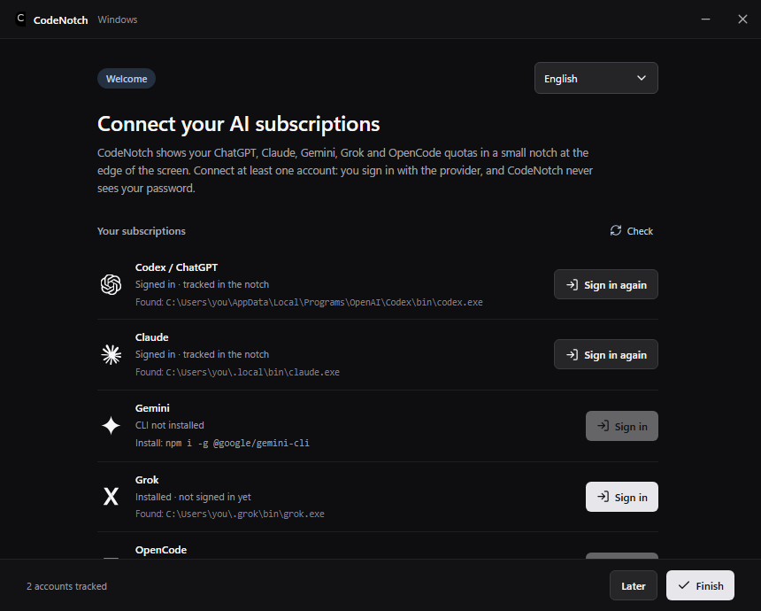
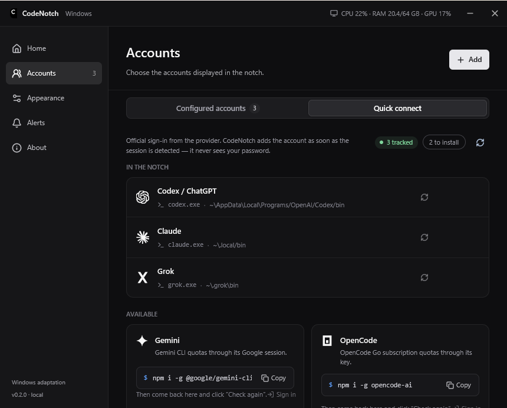
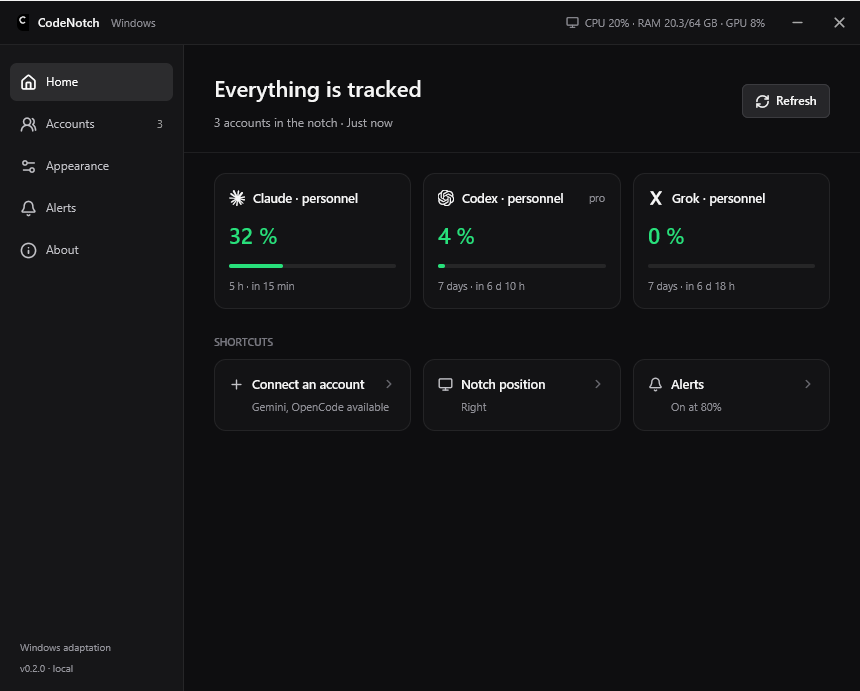
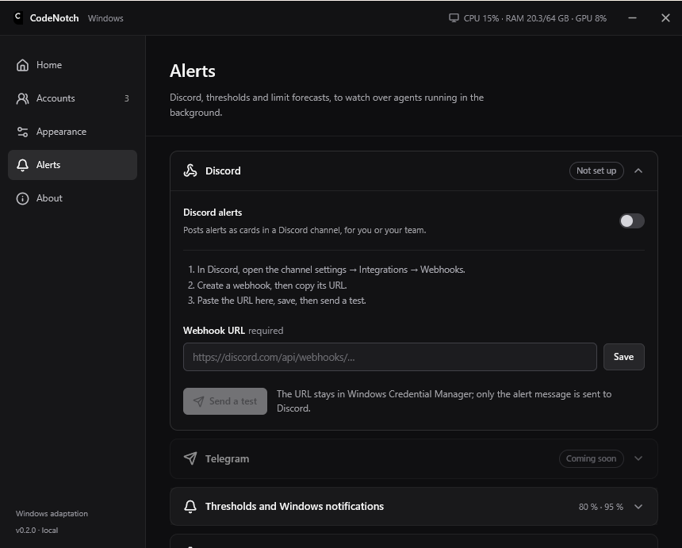

# CodeNotch for Windows

[](https://github.com/MakFly/codenotch-windows/releases/latest)
[](LICENSE)


Keep an eye on your AI account quotas from a small notch at the edge of your
Windows desktop. Hover to see usage, reset times and token activity when the
provider reports them.

An independent Windows adaptation inspired by
[CodeNotch by Vinz](https://github.com/vinzdg/codenotch), written in Rust with
[GPUI](https://www.gpui.rs), the native UI framework behind the Zed editor.
Since 0.2.0 it no longer needs WebView2. This is not an official OpenAI,
Anthropic or GitHub app.

[Download v0.2.1](https://github.com/MakFly/codenotch-windows/releases/tag/v0.2.1)
· [Français](docs/README.fr.md) · [Changelog](CHANGELOG.md)


## Features

- Native Rust app: small, fast to start, no browser engine.
- Compact quota rings for each enabled account and details on hover.
- A **Home** page with every account's main window, reset times, a 24 h / 7 d / 30 d
  history line and a CSV export.
- An optional usage gauge on the tray icon, with every account's quota in its tooltip.
- An optional system-wide shortcut to show the notch (Ctrl+Alt+N) or toggle game mode (Ctrl+Alt+G).
- Optional launch at Windows startup.
- The computer's live CPU, RAM and GPU use in the settings header.
- Automatic collapse when the pointer leaves; four configurable screen edges.
- Four screen edges; moving the notch by its grip is not ported to the native app yet.
- Automatic hiding during full-screen games and videos, plus manual game mode.
- Multiple profiles per provider and local Codex / Claude profile detection.
- Separate settings, modal account editing and threshold alerts (Windows notifications, Telegram, Discord).
- **English by default**, with saved English / French selection.
- Local account handling, Windows Credential Manager storage and no app telemetry.

## Download and run

1. Open [Releases](https://github.com/MakFly/codenotch-windows/releases/latest).
2. Download and run `CodeNotch-0.2.1-windows-x64-setup.exe`.
3. Launch CodeNotch from the Start menu. Hover over the small tab on the right edge of the screen.
4. Open the settings from the notch or the tray icon to configure accounts.

The installer installs for your Windows account, creates shortcuts and adds an
entry to Windows Installed apps for removal.

**Coming from 0.1.x?** Nothing to do: the built-in updater offers the new version, installs
it over the previous version, and keeps your accounts and settings.

For portable use, download and extract `CodeNotch-0.2.1-windows-x64.zip`, then run
`CodeNotch.exe`. The ZIP includes the license, third-party notices and a
getting-started guide. A standalone executable is also available.

Requires **Windows 10/11 x64**.
The installer and portable executable are unsigned. Windows may display a
SmartScreen warning or block unsigned applications under Smart App Control;
installation is not guaranteed on every security configuration. See
[Microsoft's explanation](https://learn.microsoft.com/windows/apps/package-and-deploy/smartscreen-reputation).
To start CodeNotch with Windows, turn on **Appearance → Notch → Launch at Windows startup**. Updates are built in: CodeNotch checks GitHub Releases at launch and twice a day, verifies the signature of the new installer, and installs it in one click from **Settings** (or **Appearance → Updates**).

Verify downloads against `SHA256SUMS.txt` using PowerShell:

```powershell
Get-FileHash .\CodeNotch-0.2.1-windows-x64.zip -Algorithm SHA256
```

## Connect your accounts



On first launch, CodeNotch opens a welcome screen to connect your subscriptions
(you can show it again from **Appearance**). Afterwards, open
**Settings → Accounts → Quick connect** and click **Sign in** next to
Codex / ChatGPT, Claude, Gemini, Grok or OpenCode, then finish in your browser:

- **Codex / ChatGPT** signs in without a terminal. CodeNotch asks the Codex App
  Server for the official ChatGPT OAuth page and opens it. Codex hosts the
  callback and saves the session, as the Codex apps do. If the callback port is
  busy, a one-time device code is shown instead.
- **Claude**, **Gemini**, **Grok** and **OpenCode** open their official CLI sign-in (`claude auth login`, `grok login`, `opencode auth login`,
  Gemini CLI → Login with Google) in a small window. Anthropic does not allow
  third-party apps to run Claude.ai sign-in themselves.

CodeNotch then detects the new session and adds the account. Each row shows
which CLI was found, or the command that installs it. CodeNotch never sees the
authorization code or the token exchange.



| Provider | Connection | Available readings |
| --- | --- | --- |
| Codex / ChatGPT | Quick connect (in-app ChatGPT OAuth through Codex), Codex CLI or the Codex app | Subscription quota windows; token activity when available through App Server |
| Claude Code | Quick connect (`claude auth login`), existing CLI OAuth profile, or configured OAuth token | 5-hour, 7-day and model-specific windows when reported |
| Gemini | Quick connect (Gemini CLI → Login with Google) | Per-model request quotas from the internal Code Assist endpoint while the CLI session is valid; CodeNotch never refreshes it (run Gemini CLI again when it expires) |
| Grok | Quick connect (`grok login`, Grok Build CLI) | Credits used in the current weekly or monthly period, from the internal billing endpoint. Expired sessions are renewed by running `grok models` (no prompt). |
| OpenCode | Quick connect (`opencode auth login` → OpenCode Go) | 5-hour, 7-day and monthly windows of an OpenCode Go subscription; other OpenCode providers have no quota |
| GitHub Copilot | Configured token, `GH_TOKEN` or `GITHUB_TOKEN` with Copilot access | Quotas from the internal Copilot endpoint |
| Ollama | Local `/api/ps` endpoint | Loaded models; no invented token quota |
| Custom endpoint | An HTTPS JSON usage endpoint | Quotas, tokens and history in the format below |

Local detection looks for `.codex`, `.codex-*`, `.claude`, `.claude-*` and
`.gemini` in your user folder, plus `CODEX_HOME`, `CLAUDE_CONFIG_DIR` and
`GEMINI_CLI_HOME`. CLIs are found from their native installers, the live and
saved `PATH`, npm (including a custom prefix), pnpm, bun, Volta, Scoop, WinGet
and Chocolatey. CodeNotch also finds the copies bundled with the Codex and Claude
desktop apps. You can also configure an absolute profile path.

Sign in through the provider's own tool. A standard API key does **not**
automatically grant access to subscription quotas. Expired Claude sessions
are renewed through the installed Claude Code CLI without sending a prompt;
if renewal fails, use **Sign in again** or run `claude auth login`.

Claude, Gemini and Copilot rely on **internal endpoints** that can change. Gemini, Copilot,
Ollama and custom endpoints still need broader testing with different accounts.
This app does not provide native connectors for every AI service.

## Settings



The settings open on **Home**: the main quota window of every account in the
notch, when it resets, and shortcuts to connect another account, move the notch
or tune alerts. The header shows the computer's live CPU, RAM and GPU use.


Pages are grouped into collapsible sections (one open at a time, remembered).

- **Appearance → Interface language** switches English / Français.
- **Appearance → Updates** shows the version and checks for a new one on demand.
- **Appearance → Notch** sets the screen edge (dragging the grip is not ported to the native app yet).
- **Auto-collapse** controls the idle tab. Details close when the pointer leaves.
- **Hide in full screen** suppresses the notch and alerts during full-screen apps.
- **Game mode** keeps them hidden until disabled, including after a restart.
- Closing settings keeps tracking active. Tray menu → **Quit** exits the app.

## What the numbers mean

Quota percentages represent **consumption**, not remaining tokens. Token
counts appear only when reported by the provider. Missing readings stay a
dash; failed readings are marked as unavailable or outdated, never replaced
with zero.

Refresh intervals are 30, 60, 120 or 300 seconds. Claude enforces a minimum of
120 seconds, including manual refresh. HTTP 429 responses respect retry delays.
Successful readings are kept for 30 days in `history.jsonl`, next to the
configuration: a line when a value moves, or every five minutes otherwise. Missing
readings stay gaps in the history. It also lets the limit forecast resume right after a restart.

## Alerts (for agents running in the background)



- **Graded alerts**: warning threshold (80 % by default), critical threshold
  (95 %), and limit reached. Each level fires once per window and period; jumping
  straight to the limit sends a single alert.
- **Forecast**: CodeNotch measures the recent pace (at least 3 readings over 10
  minutes) and warns when the limit will arrive **before** the reset, within the
  chosen lead time (15, 30 or 60 minutes). The usage details show “Limit expected
  in …”. Near a limit, readings switch to the fastest allowed pace.
- **Quota available again** after a reset, so paused agents can resume.
- **Full screen**: forecasts, critical and limit alerts still show during games
  and in game mode (can be turned off).
- **Telegram**: create a bot with @BotFather, send it `/start`, paste its token in
  **Alerts → Telegram**, detect the chat and send a test. Alerts
  arrive as cards with a gauge, the expected limit, the reset time and a link to
  the provider's usage page. The token stays in Windows Credential Manager and is
  never shown again; only the alert text goes to Telegram.
- **Discord**: in the channel settings, open **Integrations → Webhooks**, create a
  webhook and paste its URL in **Alerts → Discord**. Alerts arrive as coloured
  embeds with a gauge and timestamps shown in each reader's timezone; mentions are
  disabled. Only `discord.com` webhook URLs are accepted, and the URL is kept in
  Windows Credential Manager.

## Privacy and storage

- No CodeNotch server, analytics or telemetry; readings go directly to configured providers.
- Existing authentication stays in the provider's local profile.
- Added secrets use **Windows Credential Manager**, under the `SmashToken` service name.
- Configuration: `%APPDATA%\dev.kev.smashtoken\config.gpui.json`. On its first
  launch, 0.2.0 starts from the `config.json` of earlier versions, which it never modifies.
- Custom endpoints require HTTPS, except HTTP on localhost. Redirects are blocked; responses are limited to 2 MB.

Do not share authentication files or personal usage screenshots in issues.
See [Security](SECURITY.md) for private vulnerability reporting.

## Build locally

Install Rust stable with the MSVC toolchain and Visual Studio Build Tools with
**Desktop development with C++**. The whole app, provider connectors included,
lives in `gpui-app/`; the English strings are in `gpui-app/assets/messages.en.json`.

```powershell
git clone https://github.com/MakFly/codenotch-windows.git
cd codenotch-windows\gpui-app
cargo run -- --settings
```

```powershell
cargo build --release
```

With [Bun](https://bun.sh) installed, the same commands run from the repository root:
`bun desktop`, `bun desktop:settings`, `bun desktop:build`, `bun run test`.

The native binary is generated at `gpui-app/target/release/codenotch-gpui.exe`.
Internal package and configuration identifiers retain the original `smashtoken`
name. Release downloads use `CodeNotch.exe`.

### Publishing a release

The in-app updater, in the native app and in the 0.1.x Tauri builds, only installs an
installer signed with the project's key, for the version the feed announces. The
public key is in `gpui-app/src/updater.rs`; keep the private key out of the
repository. Signing uses the Tauri CLI's `signer`, the only Tauri tool still used.

The installer script is `gpui-app/installer/installer.nsi`. It keeps the product
name, install folder, uninstall entry and `smashtoken.exe` binary name of the
Tauri builds, so updates install over them. It is built with the `makensis` (and
its `nsis_tauri_utils` plugin) that the Tauri CLI downloads to
`%LOCALAPPDATA%\tauri\NSIS`.

```powershell
cd gpui-app; cargo build --release; cd ..
bun install --frozen-lockfile
$env:TAURI_SIGNING_PRIVATE_KEY_PATH = "$env:USERPROFILE\.tauri\codenotch.key"
$env:TAURI_SIGNING_PRIVATE_KEY_PASSWORD = ""  # the current key has no password
bun run release:package
```

`release/` then holds the signed `CodeNotch-<version>-windows-x64-setup.exe`,
`latest.json`, the portable files and `SHA256SUMS.txt`. Upload them all to the
GitHub release tagged `v<version>`: installed apps read
`releases/latest/download/latest.json`.

## Custom JSON endpoint

```json
{
  "plan": "My subscription",
  "windows": [
    { "label": "Monthly quota", "usedPercent": 42, "resetsAt": "2026-11-01T00:00:00Z" }
  ],
  "tokensToday": 12345,
  "lifetimeTokens": 250000,
  "daily": [{ "date": "2026-10-24", "tokens": 12345 }]
}
```

Illustrative values. At least one recognized measure is required. Omit unknown
measures or use `null`. Reset times accept ISO 8601 or Unix seconds. An optional
Bearer token is sent only to the configured URL. A standard chat API does not
automatically return this format.

## Contributing and credits

See [CONTRIBUTING.md](CONTRIBUTING.md) and [CHANGELOG.md](CHANGELOG.md).

- [CodeNotch / Vinz](https://github.com/vinzdg/codenotch): visual and functional reference, adapted provider glyphs and formats.
- [Coucou / Louis-CFM](https://github.com/Louis-CFM/coucou): initial Tauri reference; no Coucou code or media is bundled.
- [GPUI](https://www.gpui.rs) by Zed Industries, Lucide icons, and, for the 0.1.x builds, React, Tauri and Radix UI, with their respective contributors.

Licensed under [MIT](LICENSE). Preserve the upstream attribution in
[THIRD_PARTY_NOTICES.md](THIRD_PARTY_NOTICES.md).
