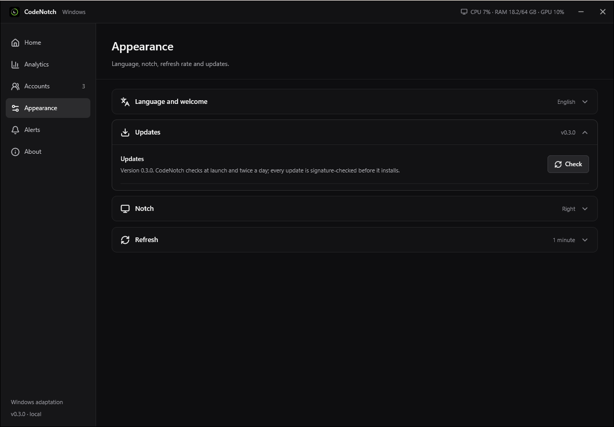

# CodeNotch for Windows

[](https://github.com/MakFly/codenotch-windows/releases/latest)
[](LICENSE)


Keep an eye on your AI account quotas from a small notch at the edge of your
Windows desktop. Hover to see usage, reset times and token activity when the
provider reports them.

An independent Windows adaptation inspired by
[CodeNotch by Vinz](https://github.com/vinzdg/codenotch), built with Tauri 2,
Rust, React and TypeScript. This is not an official OpenAI, Anthropic or GitHub app.

[Download v0.1.0](https://github.com/MakFly/codenotch-windows/releases/tag/v0.1.0)
· [Français](docs/README.fr.md) · [Changelog](CHANGELOG.md)


*Preview uses fictional data. The Windows app reads your configured accounts.*

## Features

- Compact quota rings for each enabled account and details on hover.
- Automatic collapse when the pointer leaves; four configurable screen edges.
- Draggable placement with remembered monitor position.
- Automatic hiding during full-screen games and videos, plus manual game mode.
- Multiple profiles per provider and local Codex / Claude profile detection.
- Separate settings, modal account editing and optional threshold notifications.
- **English by default**, with saved English / French selection.
- Local account handling, Windows Credential Manager storage and no app telemetry.

## Download and run

1. Open [Releases](https://github.com/MakFly/codenotch-windows/releases/latest).
2. Download and run `CodeNotch-0.1.0-windows-x64-setup.exe`.
3. Launch CodeNotch from the Start menu. Hover over the small tab on the right edge of the screen.
4. Open the settings wheel to configure accounts.

The installer installs for your Windows account, creates shortcuts and adds an
entry to Windows Installed apps for removal. If WebView2 is missing, it downloads
Microsoft's runtime installer; an internet connection is needed for that step.

For portable use, download and extract `CodeNotch-0.1.0-windows-x64.zip`, then run
`CodeNotch.exe`. The ZIP includes the license, third-party notices and a
getting-started guide. A standalone executable is also available.

Requires **Windows 10/11 x64** and the
[Microsoft Edge WebView2 Runtime](https://developer.microsoft.com/microsoft-edge/webview2/).
The installer and portable executable are unsigned. Windows may display a
SmartScreen warning or block unsigned applications under Smart App Control;
installation is not guaranteed on every security configuration. See
[Microsoft's explanation](https://learn.microsoft.com/windows/apps/package-and-deploy/smartscreen-reputation).
There is no automatic startup or automatic updater.

Verify downloads against `SHA256SUMS.txt` using PowerShell:

```powershell
Get-FileHash .\CodeNotch-0.1.0-windows-x64.zip -Algorithm SHA256
```

## Connect your accounts

On first launch, CodeNotch opens a welcome screen to connect your subscriptions
(you can show it again from **Appearance and alerts**). Afterwards, open
**Settings → Accounts → Quick connect** and click **Sign in** next to
Codex / ChatGPT, Claude, Gemini, Grok or OpenCode, then finish in your browser:

- **Codex / ChatGPT** signs in without a terminal. CodeNotch asks the Codex App
  Server for the official ChatGPT OAuth page and opens it. Codex hosts the
  callback and saves the session, as the Codex apps do. If the callback port is
  busy, a one-time device code is shown instead.
- **Claude**, **Gemini**, **Grok** and **OpenCode** open their official CLI sign-in (`claude auth login`, `grok login`, `opencode auth login`,
  Gemini CLI → Login with Google) in a small window. Anthropic does not allow
  third-party apps to run Claude.ai sign-in themselves.

CodeNotch then detects the new session and adds the account. Each row shows
which CLI was found, or the command that installs it. CodeNotch never sees the
authorization code or the token exchange.

| Provider | Connection | Available readings |
| --- | --- | --- |
| Codex / ChatGPT | Quick connect (in-app ChatGPT OAuth through Codex), Codex CLI or the Codex app | Subscription quota windows; token activity when available through App Server |
| Claude Code | Quick connect (`claude auth login`), existing CLI OAuth profile, or configured OAuth token | 5-hour, 7-day and model-specific windows when reported |
| Gemini | Quick connect (Gemini CLI → Login with Google) | Per-model request quotas from the internal Code Assist endpoint while the CLI session is valid; CodeNotch never refreshes it (run Gemini CLI again when it expires) |
| Grok | Quick connect (`grok login`, Grok Build CLI) | Credits used in the current weekly or monthly period, from the internal billing endpoint. Expired sessions are renewed by running `grok models` (no prompt). |
| OpenCode | Quick connect (`opencode auth login` → OpenCode Go) | 5-hour, 7-day and monthly windows of an OpenCode Go subscription; other OpenCode providers have no quota |
| GitHub Copilot | Configured token, `GH_TOKEN` or `GITHUB_TOKEN` with Copilot access | Quotas from the internal Copilot endpoint |
| Ollama | Local `/api/ps` endpoint | Loaded models; no invented token quota |
| Custom endpoint | An HTTPS JSON usage endpoint | Quotas, tokens and history in the format below |

Local detection looks for `.codex`, `.codex-*`, `.claude`, `.claude-*` and
`.gemini` in your user folder, plus `CODEX_HOME`, `CLAUDE_CONFIG_DIR` and
`GEMINI_CLI_HOME`. CLIs are found from their native installers, the live and
saved `PATH`, npm (including a custom prefix), pnpm, bun, Volta, Scoop, WinGet
and Chocolatey. CodeNotch also finds the copies bundled with the Codex and Claude
desktop apps. You can also configure an absolute profile path.

Sign in through the provider's own tool. A standard API key does **not**
automatically grant access to subscription quotas. Expired Claude sessions
are renewed through the installed Claude Code CLI without sending a prompt;
if renewal fails, use **Sign in again** or run `claude auth login`.

Claude, Gemini and Copilot rely on **internal endpoints** that can change. Gemini, Copilot,
Ollama and custom endpoints still need broader testing with different accounts.
This app does not provide native connectors for every AI service.

## Settings



- **Appearance and alerts → Interface language** switches English / Français.
- Drag the grip to save position and monitor. Choosing another edge resets placement.
- **Auto-collapse** controls the idle tab. Details close when the pointer leaves.
- **Hide in full screen** suppresses the notch and alerts during full-screen apps.
- **Game mode** keeps them hidden until disabled, including after a restart.
- Closing settings keeps tracking active. Tray menu → **Quit** exits the app.

## What the numbers mean

Quota percentages represent **consumption**, not remaining tokens. Token
counts appear only when reported by the provider. Missing readings stay a
dash; failed readings are marked as unavailable or outdated, never replaced
with zero.

Refresh intervals are 30, 60, 120 or 300 seconds. Claude enforces a minimum of
120 seconds, including manual refresh. HTTP 429 responses respect retry delays.
Notifications occur when a comparable quota crosses a threshold, without
repeating while it remains above it. Readings stay in memory for the session;
any history comes from the provider.

## Privacy and storage

- No CodeNotch server, analytics or telemetry; readings go directly to configured providers.
- Existing authentication stays in the provider's local profile.
- Added secrets use **Windows Credential Manager**, under the `SmashToken` service name.
- Configuration: `%APPDATA%\dev.kev.smashtoken\config.json`.
- The renderer receives usage readings, not authentication tokens.
- Custom endpoints require HTTPS, except HTTP on localhost. Redirects are blocked; responses are limited to 2 MB.

Do not share authentication files or personal usage screenshots in issues.
See [Security](SECURITY.md) for private vulnerability reporting.

## Build locally

Install [Bun](https://bun.sh), Rust stable with the MSVC toolchain, WebView2,
and Visual Studio Build Tools with **Desktop development with C++**.
See [Tauri's Windows prerequisites](https://v2.tauri.app/start/prerequisites/).

```powershell
git clone https://github.com/MakFly/codenotch-windows.git
cd codenotch-windows
bun install --frozen-lockfile
bun run desktop
```

```powershell
bun run test
bun run test:native
bun run build
bun run desktop:build --no-bundle
```

The native binary is generated at `src-tauri/target/release/smashtoken.exe`.
To also build the NSIS installer locally, run `bun run desktop:build` without
`--no-bundle`. The installer is generated in `src-tauri/target/release/bundle/nsis/`.
Internal package and configuration identifiers retain the original `smashtoken`
name. Release downloads use `CodeNotch.exe`.

For UI tests, run `bun run dev` in another terminal, then:

```powershell
bunx playwright install chromium
bun run test:ui
```

`http://127.0.0.1:1437/?demo=1` is a fictional-data preview. Browser previews
cannot access local provider accounts; demo mode is disabled in Tauri.

## Custom JSON endpoint

```json
{
  "plan": "My subscription",
  "windows": [
    { "label": "Monthly quota", "usedPercent": 42, "resetsAt": "2026-11-01T00:00:00Z" }
  ],
  "tokensToday": 12345,
  "lifetimeTokens": 250000,
  "daily": [{ "date": "2026-10-24", "tokens": 12345 }]
}
```

Illustrative values. At least one recognized measure is required. Omit unknown
measures or use `null`. Reset times accept ISO 8601 or Unix seconds. An optional
Bearer token is sent only to the configured URL. A standard chat API does not
automatically return this format.

## Contributing and credits

See [CONTRIBUTING.md](CONTRIBUTING.md) and [CHANGELOG.md](CHANGELOG.md).

- [CodeNotch / Vinz](https://github.com/vinzdg/codenotch): visual and functional reference, adapted provider glyphs and formats.
- [Coucou / Louis-CFM](https://github.com/Louis-CFM/coucou): initial Tauri reference; no Coucou code or media is bundled.
- React, Tauri, Radix UI, Lucide and their respective contributors.

Licensed under [MIT](LICENSE). Preserve the upstream attribution in
[THIRD_PARTY_NOTICES.md](THIRD_PARTY_NOTICES.md).
