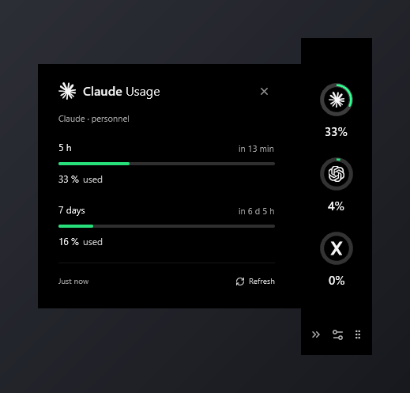

# CodeNotch pour Windows

[English](../README.md) · [Télécharger la version 0.1.3](https://github.com/MakFly/codenotch-windows/releases/tag/v0.1.3)

Une encoche discrète pour suivre les quotas de vos comptes IA sur Windows.
Survolez un compte pour voir sa consommation et ses échéances de remise à
zéro. Les compteurs de tokens apparaissent lorsque le fournisseur les publie.

Adaptation Windows indépendante inspirée de
[CodeNotch de Vinz](https://github.com/vinzdg/codenotch), réalisée avec Tauri,
Rust, React et TypeScript. Ce projet n'est pas une application officielle des
fournisseurs concernés.



## Installer

1. Téléchargez `CodeNotch-0.1.3-windows-x64-setup.exe` depuis les releases.
2. Lancez l'installateur, puis CodeNotch depuis le menu Démarrer.
3. Survolez la languette au bord droit et ouvrez les réglages avec la roue.
4. Pour le français : **Appearance → Interface language → Français**.

L'application s'installe pour votre compte Windows, avec raccourcis et
désinstallation depuis les applications installées de Windows. Si WebView2
manque, l'installateur télécharge le programme d'installation Microsoft : cette
étape nécessite une connexion internet. Windows 10/11 x64 est requis.

Une version portable reste disponible : décompressez
`CodeNotch-0.1.3-windows-x64.zip` et lancez `CodeNotch.exe`.

L'installateur et l'application ne sont pas signés. SmartScreen peut afficher
une alerte et Smart App Control peut bloquer leur exécution selon la configuration
de sécurité. Voir les [explications de Microsoft](https://learn.microsoft.com/windows/apps/package-and-deploy/smartscreen-reputation).
Pas de démarrage ni de mise à jour automatiques. Les empreintes des téléchargements
figurent dans `SHA256SUMS.txt`.

## Utiliser

- Codex / ChatGPT, Claude Code, Gemini, Copilot, Ollama et endpoints JSON personnalisés.
- Plusieurs profils par fournisseur ; détection locale des profils Codex, Claude et Gemini.
- Quatre bords possibles, déplacement par la poignée et position mémorisée.
- Détails au survol et repli automatique au départ de la souris.
- Masquage en plein écran et mode jeu manuel pour les jeux en fenêtre.
- Réglages séparés, formulaires en modale et notifications de seuil optionnelles.
- Anglais par défaut, français disponible et choix enregistré.

Dans **Réglages → Comptes → Connexion rapide**, cliquez sur **Se connecter**
à côté de Codex / ChatGPT, Claude, Gemini, Grok ou OpenCode, puis terminez dans le navigateur.
Codex se connecte sans terminal : CodeNotch obtient la page OAuth ChatGPT
officielle via le Codex App Server et l'ouvre ; un code d'appareil s'affiche si
le port de retour est occupé. Claude, Gemini, Grok et OpenCode ouvrent leur connexion CLI
officielle dans une petite fenêtre, car Anthropic interdit aux applications
tierces de gérer elles-mêmes la connexion Claude.ai. CodeNotch détecte ensuite
la session et ajoute le compte. La détection couvre aussi PATH enregistré, npm,
pnpm, bun, Volta, Scoop, WinGet, Chocolatey et les copies fournies avec les
applications de bureau Codex et Claude. CodeNotch ne voit jamais le code
d'autorisation ni les jetons échangés.

Vous pouvez aussi vous connecter depuis les outils des fournisseurs. Une clé API ne donne
pas automatiquement accès aux quotas d'un abonnement. Une session Claude
expirée peut être renouvelée par le CLI installé sans envoyer de prompt ; si
cela échoue, utilisez **Reconnecter** ou `claude auth login`.

Les endpoints Claude, Gemini et Copilot sont internes et peuvent changer.
CodeNotch ne renouvelle jamais la session Gemini : relancez Gemini CLI quand elle expire. Ollama
affiche les modèles chargés, sans inventer de consommation de tokens.
Copilot, Ollama et les adaptateurs personnalisés nécessitent davantage de
validation sur différents comptes.

## Données et confidentialité

Un quota représente un pourcentage **consommé**, pas des tokens restants.
Une mesure absente reste un tiret ; une mesure ancienne est signalée.
Les relevés restent en mémoire pendant la session, pas entre lancements.
Les délais des réponses HTTP 429 sont respectés ; Claude est interrogé au
maximum une fois toutes les deux minutes.

Pas de serveur CodeNotch ni de télémétrie. Les sessions restent dans les
profils locaux des fournisseurs. Les secrets ajoutés utilisent le Gestionnaire
d'identification Windows, service `SmashToken`. Configuration :
`%APPDATA%\dev.kev.smashtoken\config.json`.

Fermer les réglages laisse le suivi actif. Pour quitter : icône CodeNotch près
de l'horloge → **Quitter**. N'incluez aucun secret dans un ticket public.

## Développer

Prérequis : Bun, Rust stable MSVC, Visual Studio Build Tools avec
« Développement Desktop en C++ », WebView2.

```powershell
git clone https://github.com/MakFly/codenotch-windows.git
cd codenotch-windows
bun install --frozen-lockfile
bun run desktop
```

```powershell
bun run test
bun run test:native
bun run build
bun run desktop:build --no-bundle
```

Binaire : `src-tauri/target/release/smashtoken.exe`.
Pour compiler aussi l'installateur NSIS, lancez `bun run desktop:build` sans
`--no-bundle`. Résultat dans `src-tauri/target/release/bundle/nsis/`.
Le format des endpoints JSON personnalisés, les tests d'interface et les
instructions de contribution figurent dans le [README anglais](../README.md)
et [CONTRIBUTING.md](../CONTRIBUTING.md).

## Licence et crédits

[MIT](../LICENSE). Référence principale :
[CodeNotch de Vinz](https://github.com/vinzdg/codenotch).
[Coucou](https://github.com/Louis-CFM/coucou) a inspiré le choix initial de Tauri,
sans inclusion de son code ni de ses médias.
Voir [THIRD_PARTY_NOTICES.md](../THIRD_PARTY_NOTICES.md).
