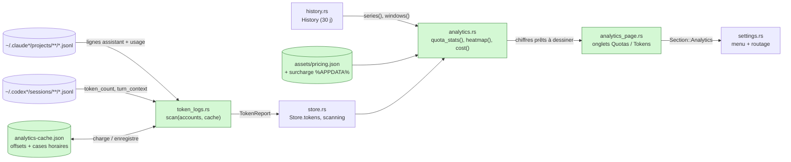
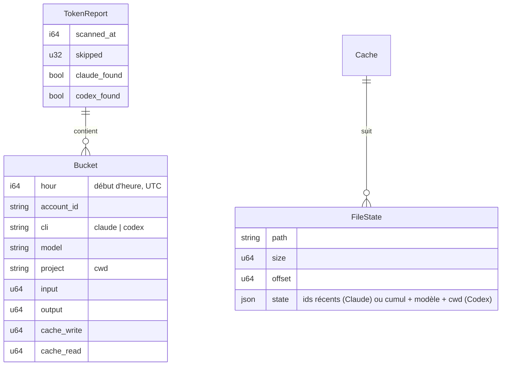
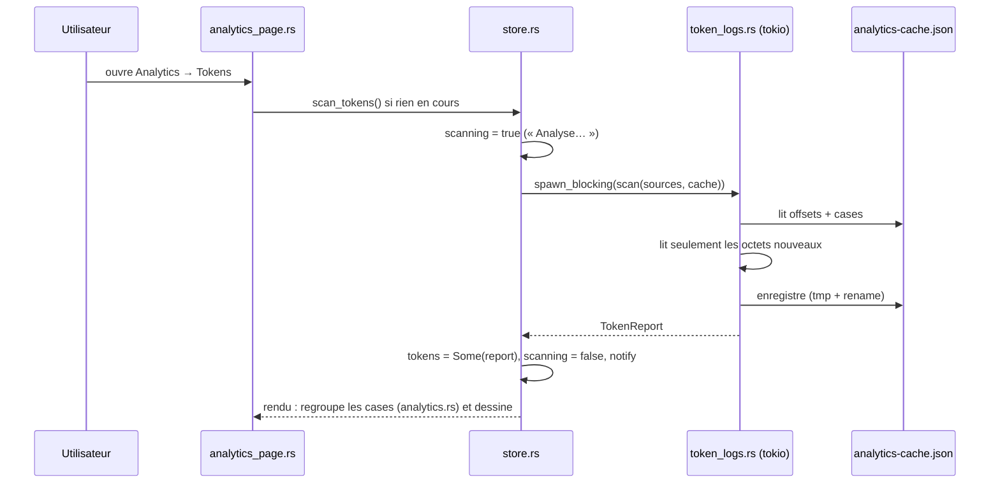

# Design technique - Analytics locales

- **Spec :** [spec.md](spec.md) (approuvée le 2026-10-30)
- **Statut :** Approuvé (2026-10-30), implémenté

## Analyse d'impact

| Zone | Fichier | Changement |
| --- | --- | --- |
| Réglages | `gpui-app/src/settings.rs` | `Section::Analytics` dans l'enum, le menu et le routage des pages ; onglets sur le modèle d'`AccountsTab` |
| Modèle | `gpui-app/src/model.rs` | `Settings` : `analytics_days`, `usd_to_eur`, `plan_prices_eur` (`#[serde(default)]`) |
| Store | `gpui-app/src/store.rs` | `tokens: Option<TokenReport>`, `scanning: bool`, `scan_tokens()` ; validation des nouvelles options |
| Historique | `gpui-app/src/history.rs` | lecture seule, via `series()` et `windows()` qui existent déjà |
| Nouveau | `gpui-app/src/token_logs.rs` | lecture incrémentale des logs Claude Code et Codex vers des cases horaires |
| Nouveau | `gpui-app/src/analytics.rs` | calculs purs : limites, temps bloqué, rythme, carte de chaleur, coûts |
| Nouveau | `gpui-app/src/analytics_page.rs` | page et graphiques (canvas GPUI) |
| Nouveau | `gpui-app/assets/pricing.json` | tarifs API en $ par million de tokens, par préfixe de modèle |
| Textes | `gpui-app/assets/messages.en.json` | traductions anglaises |

Aucune nouvelle dépendance : `serde_json`, `chrono`, `dirs` et `tokio` sont déjà là.

## Solution proposée

### Vue d'ensemble

Deux sources alimentent deux onglets :

- **Quotas** : tout est calculé à partir de `History`, déjà en mémoire. C'est instantané.
- **Tokens** : un scanner lit les logs JSONL des CLI dans un thread tokio, en ne reprenant
  chaque fichier qu'à partir de l'octet où il s'était arrêté. Il agrège les requêtes en **cases
  horaires** `(heure, compte, modèle, projet)`. Les cases et les positions de lecture sont
  gardées dans `analytics-cache.json`. La page ne fait que regrouper ces cases.

Rien n'est envoyé sur le réseau. Seuls des nombres, des noms de modèle et des chemins de dossier
sont extraits des logs, jamais le texte des messages.

### Architecture



### Composants

**`token_logs.rs`**
- `scan(sources: Vec<Source>, cache: Cache, now) -> (TokenReport, Cache)`. C'est une fonction
  pure côté données, lancée par `spawn_blocking`.
- Un `Source` vaut `{ account_id, cli: Claude | Codex, dir }`. Les dossiers viennent des comptes
  Claude et Codex activés : `profile_path`, ou `login::default_profile`, puis `projects/` ou
  `sessions/`. Deux comptes qui pointent sur le même dossier ne le lisent qu'une fois.
- **Lecture incrémentale** : pour chaque fichier, on garde `{ size, offset, état }`. Un fichier
  plus court qu'avant est relu depuis le début. On ne lit que les lignes complètes (terminées par
  `\n`), et une ligne en cours d'écriture sera lue au passage suivant.
- **Claude** : on ne parse que les lignes qui contiennent `"usage"`, vers une struct minimale
  `{ type, timestamp, cwd, requestId, message: { id, model, usage } }`. Les lignes qui
  répètent le même `message.id` + `requestId` ne comptent qu'une fois (AC-4.2) ; l'état du
  fichier garde les 256 derniers identifiants.
- **Codex** :
  - `session_meta.cwd` donne le projet, et le dernier `turn_context.model` donne le modèle.
  - Pour `event_msg/token_count`, on compte la **différence** entre son `total_token_usage` et
    le précédent, ce qui neutralise les compteurs répétés (AC-4.2).
  - Les tokens d'entrée de Codex incluent les tokens en cache : entrée hors cache =
    `input - cached`.
- Une ligne illisible est ignorée et comptée dans `skipped`, ce qui ne bloque jamais (AC-4.4).
  On garde 35 jours de cases.

**`analytics.rs`** (sans GPUI, testé unitairement)
- `quota_stats(samples, since, now) -> QuotaStats { limits, blocked_secs, per_hour }`. Les
  intervalles de plus de 30 min ne comptent ni dans le temps bloqué ni dans le rythme (AC-2.2).
- `heatmap(report, filter, since) -> [[u64; 24]; 7]`, en heure locale (`chrono::Local`).
- `daily`, `by_model`, `by_project` : des regroupements des cases.
- `Pricing::load()` part de `assets/pricing.json`. Un `pricing.json` placé à côté de la config
  peut le compléter ou le remplacer modèle par modèle, sans attendre une mise à jour.
- `cost(tokens, model, pricing) -> Option<f64>` renvoie `None` si le modèle est inconnu
  (AC-5.2). La correspondance se fait sur le **préfixe le plus long** (`claude-opus-4` couvre
  `claude-opus-4-1-20250805`).
- `suggested_plan_usd(account, reading)` :
  - Codex : `planType` vaut `plus` (20 $) ou `pro` (200 $).
  - Claude : `subscriptionType` et `rateLimitTier` dans `.credentials.json`, sans lire le jeton
    (Pro 20 $, Max 5× 100 $, Max 20× 200 $).
  - Sinon `None`, et la comparaison est masquée.

**`analytics_page.rs`** (méthodes de `SettingsView`, comme `home.rs`)
- En-tête : onglets « Quotas » et « Tokens », segments 7 j / 30 j (comme `range_toggle`), et un
  bouton Actualiser pour les tokens.
- Onglet Quotas : une carte par compte et par fenêtre. On y trouve une grande `line_chart`
  (canvas, sur le modèle de `sparkline`) avec repères verticaux à chaque changement de
  `resets_at`, et trois chiffres : limites, temps bloqué, %/h.
- Onglet Tokens :
  - un filtre CLI ;
  - les totaux (tokens, coût en €, rapport au prix de l'abonnement) ;
  - les barres empilées par jour ;
  - la carte de chaleur 7×24 en `div`, dont la case survolée est affichée en légende ;
  - le classement des modèles et des projets ;
  - les champs « prix mensuel » par compte, en € (`TextInput`, enregistrés au blur ou sur Entrée).

### Modèle de données



Nouveaux champs de `Settings`, tous `#[serde(default)]` donc compatibles avec les anciennes
configs :

- `analytics_days: u16` : 7 ou 30, 7 par défaut.
- `usd_to_eur: f64` : 0,92 par défaut, accepté entre 0,5 et 2.
- `plan_prices_eur: BTreeMap<String, f64>` : prix saisi par compte, de 0 à 1 000.

### Interfaces

```rust
// token_logs.rs
pub struct Source { pub account_id: String, pub cli: Cli, pub dir: PathBuf }
pub fn sources(accounts: &[Account]) -> Vec<Source>;
pub fn scan(sources: &[Source], cache: Cache, now: i64) -> (TokenReport, Cache);

// analytics.rs
pub fn quota_stats(samples: &[Sample], since: i64, now: i64) -> QuotaStats;
pub fn heatmap(report: &TokenReport, cli: Option<Cli>, since: i64) -> [[u64; 24]; 7];
pub fn cost_usd(t: &Tokens, model: &str, pricing: &Pricing) -> Option<f64>;

// store.rs
pub async fn scan_tokens(store: &Entity<Store>, cx: &mut AsyncApp);
```

### Flux principal



## Alternatives écartées

- **Tout relire à chaque ouverture** : ~400 Mo de logs sur ce PC, soit plusieurs secondes de
  CPU à chaque fois. La lecture incrémentale coûte un fichier de cache.
- **SQLite (`rusqlite`)** : plus de requêtes possibles, mais une dépendance native et un format
  de plus. Des cases horaires en JSON suffisent à 35 jours.
- **Un crate de graphiques (`plotters`)** : son rendu ne s'intègre pas aux couleurs et au
  thème de GPUI. Quelques `PathBuilder` suffisent, comme pour les anneaux et la sparkline.
- **La carte de chaleur à partir des % de quota** : un relevé toutes les 1 à 5 min ne donne
  qu'une estimation grossière. Les horodatages des requêtes dans les logs sont exacts.

## Risques et mitigations

| Risque | Mitigation |
| --- | --- |
| Les formats de logs changent (fichiers internes des CLI) | Parsing tolérant, champs optionnels, lignes inconnues ignorées et comptées (`skipped`, visible en petit sur la page) ; tests sur des lignes réelles anonymisées |
| Les tarifs dans `pricing.json` vieillissent ou manquent (nouveaux modèles) | Le coût d'un modèle inconnu est « non estimé », jamais zéro, et la part non estimée est affichée. Une surcharge locale est possible. Les tarifs Claude sont vérifiés à l'écriture avec la documentation officielle |
| Confidentialité : les logs contiennent les conversations | Struct minimale sans champ de contenu. Le cache ne garde que des nombres, des noms de modèle et des chemins. Aucun réseau |
| Lecture longue au premier passage (265 Mo Claude + 144 Mo Codex ici) | Thread tokio, page affichée tout de suite, filtre texte `"usage"` / `token_count` avant le parsing JSON |
| Fichier en cours d'écriture par le CLI | Seules les lignes terminées par `\n` sont lues, et l'offset n'avance qu'après elles |
| Le cache est corrompu | Il est ignoré et reconstruit, comme `history.jsonl` |

## Stratégie de test

- **Unitaires `token_logs`** (lignes JSON d'exemple écrites dans un dossier temporaire) :
  - dédoublonnage Claude ;
  - différences Codex, y compris un compteur répété ;
  - reprise à l'offset ;
  - fichier raccourci ;
  - ligne incomplète puis complétée ;
  - ligne illisible.
- **Unitaires `analytics`** :
  - limites et temps bloqué avec des trous ;
  - %/h ;
  - carte de chaleur en heure locale ;
  - préfixe de prix le plus long ;
  - modèle inconnu → `None` ;
  - conversion en euros.
- **Unitaires `model`** : une ancienne config sans les nouveaux champs se charge.
- **Manuel** avec `bun dev` : les deux onglets sur les logs réels du PC, 7 j / 30 j, filtre CLI,
  prix modifié, durée de la première analyse puis de la suivante.

## Écarts à l'implémentation

- Les prix d'abonnement et le taux sont enregistrés avec un bouton **Enregistrer** plutôt qu'au
  blur ou sur Entrée : `TextInput` n'émet pas d'événement, et c'est le même geste que pour le
  webhook Discord.
- Les prix proposés (`suggested_plan_usd`) sont calculés une fois par scan et gardés dans
  `Store.plan_suggestions_usd`. Pour Claude, ils viennent d'un fichier qu'on ne relit pas à
  chaque rendu.
- L'onglet Tokens relance un scan si le dernier date de plus de 10 minutes.
- Les fichiers non modifiés depuis plus de 35 jours ne sont jamais ouverts. Sur ce PC, le
  premier scan (~400 Mo de logs) prend 0,4 s et les suivants environ 10 ms.
- Les courbes de l'onglet Quotas utilisent `chart.rs`, un graphique en aires dans le style de
  shadcn/ui : dégradé sous la ligne, grille, axes gradués, curseur et info-bulle qui suivent le
  pointeur. Le survol est gardé dans `SettingsView.chart_hover`. L'axe des x couvre les relevés
  disponibles (au moins 1 h) plutôt que toute la période.
- `alerts::same_period` tolère 5 min d'écart sur l'heure de reset. Claude la renvoie à une
  seconde près d'un relevé à l'autre, ce qui faisait voir un faux reset, vidait le rythme de la
  prévision et pouvait renvoyer une alerte déjà envoyée.
- **Onglet Quotas refait en couloirs de budget** (à la place des cartes à courbe plate). Chaque
  fenêtre est une ligne pleine largeur dans un seul panneau, séparée des autres par un filet :
  - à gauche, l'usage actuel et l'écart en points avec le rythme régulier ;
  - au centre, toute la période, du début à la remise à zéro : une diagonale en pointillés
    pour le rythme régulier, les relevés lissés, le tronçon avant le premier relevé en
    pointillés fins, et la projection au rythme moyen jusqu'au reset (✕ si le plafond tombe
    avant) ;
  - à droite, le verdict (plafond prévu ou usage au reset) et les limites atteintes sur 7 ou
    30 j.

  Le calcul est dans `analytics::budget` / `period_length` (testés) et le dessin dans
  `chart::BudgetChart`.
- **Un compte à la fois dans l'onglet Quotas.** Une barre de puces en tête (icône, nom,
  fenêtre la plus chargée et son %) choisit le compte ; le panneau en dessous le détaille :
  une synthèse (nombre de fenêtres, plafond le plus proche ou « aucun plafond prévu »,
  limites atteintes sur la période), puis un couloir par fenêtre. Le choix vit dans
  `SettingsView.analytics_account` et retombe sur le premier compte suivi.
- Les dates sont écrites « aujourd'hui 14:20 », « demain », « hier », sinon avec le jour et la
  date (« mer 24/10 09:18 »), pour que les deux bouts d'une période de 7 jours ne se lisent
  pas pareil.
- **Largeur** : GPUI n'a pas de media queries, donc `SettingsView.viewport_width` est relevé à
  chaque rendu. Sous 1000 px, les couloirs empilent l'usage et le verdict au-dessus du
  graphique, et les paires de cartes de l'onglet Tokens passent en colonne. Les puces de
  comptes ont une largeur minimale et passent à la ligne au-delà.
- **Depuis l'Accueil**, cliquer une carte de quota ouvre Analytics → Quotas sur ce compte.
