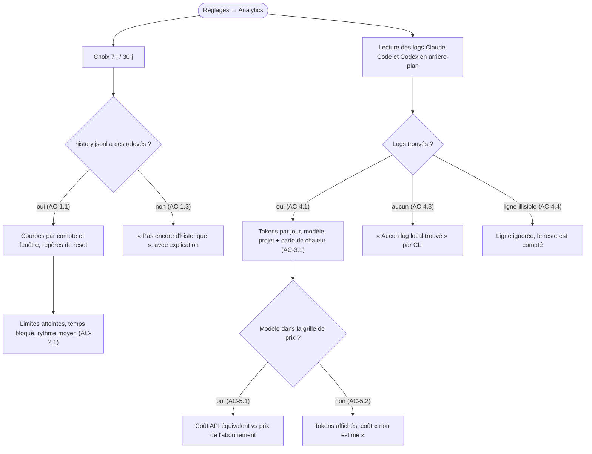

# Spec - Analytics locales

- **Slug:** local-analytics
- **Date:** 2026-10-30
- **Status:** Approved (2026-10-30)

## Contexte

CodeNotch affiche les quotas du moment. Il ne dit pas comment on les consomme dans le temps,
ni ce que cette consommation représente vraiment en tokens et en argent. Depuis la version
non publiée qui suit la 0.2.1, l'app garde 30 jours de relevés dans `history.jsonl`, mais ils
ne servent qu'à une petite courbe sur la page Accueil.

Les CLI Claude Code et Codex écrivent déjà sur le PC le détail de chaque requête (modèle,
tokens, dossier de travail). En croisant les deux sources, CodeNotch peut répondre à trois
questions :

- **Quand** est-ce que je consomme, et à quel rythme ?
- **Combien** de tokens, sur quel modèle et quel projet ?
- **Est-ce que mon abonnement est rentable**, comparé au même usage facturé au tarif API ?

Tout reste sur le PC : aucune donnée ne sort, dans la continuité de « no app telemetry ».

## User stories

- **US-1** - En tant qu'utilisateur d'abonnements IA, je veux voir l'historique détaillé de
  chaque quota, pour comprendre quand et à quelle vitesse je l'épuise.
- **US-2** - Je veux savoir combien de fois j'ai atteint une limite et combien de temps j'ai
  été bloqué, pour juger si mon abonnement est trop petit.
- **US-3** - Je veux voir à quelles heures et quels jours je consomme le plus, pour mieux
  répartir mon travail entre mes comptes.
- **US-4** - Je veux voir mes tokens par jour, par modèle et par projet, pour savoir ce qui
  coûte le plus.
- **US-5** - Je veux comparer le coût équivalent au tarif API au prix de mon abonnement, pour
  savoir s'il est rentable.

## Parcours utilisateur

## Critères d'acceptation

### US-1 - Historique détaillé

- **AC-1.1** - Courbes
  - Étant donné un historique sur la période choisie
  - Quand j'ouvre Analytics
  - Alors chaque compte suivi a une grande courbe par fenêtre de quota (5 h, 7 jours…), un
    repère vertical à chaque remise à zéro, et un trou là où il n'y a pas de relevé.
- **AC-1.2** - Période
  - Quand je passe de 7 j à 30 j
  - Alors toutes les courbes et tous les chiffres de la page suivent, et le choix est retenu.
- **AC-1.3** - Pas d'historique
  - Étant donné un compte sans relevé sur la période
  - Alors sa carte dit « Pas encore d'historique » au lieu d'une courbe vide ou à zéro.

### US-2 - Limites et rythme

- **AC-2.1** - Compteurs
  - Étant donné l'historique d'une fenêtre
  - Alors la page affiche, sur la période : le nombre de fois où elle a atteint 100 %, le
    temps total passé à 100 %, et la consommation moyenne par heure active (points de % gagnés
    par heure où le quota a monté).
- **AC-2.2** - Trous
  - Étant donné l'app fermée pendant une limite
  - Alors le temps bloqué ne compte pas au-delà du dernier relevé suivi d'un trou de plus de
    30 min : on ne compte que ce qui a été observé.

### US-3 - Moments de consommation

- **AC-3.1** - Carte de chaleur
  - Étant donné des requêtes dans les logs sur la période
  - Alors une grille 7 jours × 24 heures (heure locale) colore chaque case selon les tokens
    consommés, et le survol d'une case affiche le total.
- **AC-3.2** - Filtre
  - Quand je choisis un CLI (Tous, Claude Code, Codex)
  - Alors la carte de chaleur et les totaux ne comptent que ce CLI.

### US-4 - Tokens

- **AC-4.1** - Totaux
  - Étant donné des logs Claude Code et Codex sur la période
  - Alors je vois les tokens par jour (barres empilées entrée / sortie / cache), un classement
    par modèle et un classement par projet (nom du dossier de travail, chemin complet au survol).
- **AC-4.2** - Pas de double compte
  - Étant donné une réponse Claude écrite sur plusieurs lignes (un bloc de contenu par ligne)
    ou une session Codex qui répète un compteur
  - Alors chaque requête n'est comptée qu'une fois.
- **AC-4.3** - Aucun log
  - Étant donné un CLI absent ou jamais utilisé
  - Alors sa section dit « Aucun log local trouvé », avec le dossier cherché.
- **AC-4.4** - Log abîmé
  - Étant donné une ligne illisible ou d'un format inconnu
  - Alors elle est ignorée sans erreur et le reste est compté.
- **AC-4.5** - Fluidité
  - Étant donné des centaines de Mo de logs
  - Alors la page s'ouvre tout de suite avec un indicateur « Analyse… ». La première lecture
    tourne en arrière-plan, et les suivantes ne relisent que ce qui a changé.

### US-5 - Rentabilité

- **AC-5.1** - Coût équivalent
  - Étant donné des tokens sur des modèles présents dans la grille de prix
  - Alors je vois le coût qu'ils auraient eu au tarif API, par jour et au total sur la période,
    comparé au prix de l'abonnement ramené à la même durée, avec un verdict
    (« 4,2× la valeur de ton abonnement »).
- **AC-5.2** - Modèle inconnu
  - Étant donné un modèle absent de la grille
  - Alors ses tokens sont comptés, son coût est « non estimé », et le total précise la part non
    estimée. On ne remplace jamais un prix inconnu par zéro.
- **AC-5.3** - Prix de l'abonnement
  - Étant donné un compte Claude ou Codex
  - Quand je règle son prix mensuel (proposé d'après le forfait détecté, modifiable)
  - Alors la comparaison l'utilise. Sans prix, la comparaison est masquée.
- **AC-5.4** - Euros
  - Étant donné les tarifs API en dollars
  - Alors tous les coûts et prix d'abonnement sont affichés et saisis en euros. Le taux $ → €
    est réglable (0,92 par défaut), et la page le rappelle sous le total.

## Hors périmètre

- Gemini, Grok, OpenCode et Copilot : pas de logs locaux de tokens exploitables pour l'instant.
  Leurs quotas restent dans les courbes de l'US-1.
- Les sessions Codex archivées et compressées (`.jsonl.zst`).
- Le détail par conversation ou par prompt : jamais de contenu de message lu ou affiché.
- Tout envoi réseau, toute télémétrie.
- L'export CSV des tokens (l'export de l'historique des quotas existe déjà).

## Hypothèses

- Les logs Claude Code sont dans `~/.claude/projects/**/*.jsonl` (et les dossiers
  `CLAUDE_CONFIG_DIR` des profils suivis). Une réponse = les lignes `assistant` avec le même
  `message.id` + `requestId`. Leur `message.usage` donne les tokens d'entrée, de sortie, de
  création et de lecture de cache, et `cwd` donne le projet.
- Les logs Codex sont dans `~/.codex/sessions/AAAA/MM/JJ/*.jsonl` (et `CODEX_HOME`). Les
  tokens viennent des événements `token_count`, en différence du cumul
  `total_token_usage`. Le modèle vient de `turn_context`, et le projet de `cwd`.
- La grille de prix est un fichier livré avec l'app (`assets/pricing.json`, en $ par million de
  tokens). Elle se met à jour avec l'app, et le coût est affiché en dollars.
- La carte de chaleur et les totaux de tokens ne concernent que Claude Code et Codex.
- Seuls des nombres sont extraits des logs : modèle, tokens, horodatage et dossier de travail.
  Aucun texte de conversation n'est lu ni gardé.

## Décisions (porte 1)

- **Prix des abonnements** : proposés d'après le forfait détecté, modifiables par compte.
- **Devise** : les coûts sont affichés en **euros**, convertis depuis les tarifs API en dollars
  avec un taux réglable (AC-5.4).
- **Place** : une entrée « Analytics » dans le menu des réglages, avec deux onglets « Quotas »
  (US-1 à US-2) et « Tokens » (US-3 à US-5).
