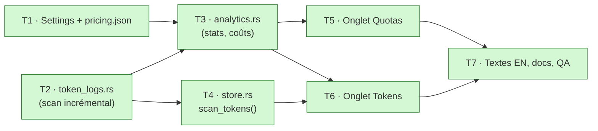

# Tâches - Analytics locales

- **Spec :** [spec.md](spec.md) · **Design :** [design.md](design.md)

| # | Tâche | Critères | Fait |
| --- | --- | --- | --- |
| T1 | Ajouter `analytics_days`, `usd_to_eur` et `plan_prices_eur` dans `Settings`, avec leur validation dans `save_settings`, et `assets/pricing.json` avec `Pricing::load` (surcharge locale) | AC-1.2, AC-5.3, AC-5.4 | [x] |
| T2 | `token_logs.rs` : sources depuis les comptes, scan Claude (dédoublonnage) et Codex (différences), offsets, cache, tests | AC-4.1 à AC-4.5 | [x] |
| T3 | `analytics.rs` : `quota_stats`, `heatmap`, regroupements, `cost_usd`, `suggested_plan_usd`, tests | AC-2.1, AC-2.2, AC-3.1, AC-5.1, AC-5.2 | [x] |
| T4 | `Store.tokens` / `scanning` et `scan_tokens()` en arrière-plan | AC-4.5 | [x] |
| T5 | `Section::Analytics`, onglets, segments 7 j / 30 j, onglet Quotas (grande courbe avec repères, trois chiffres, état vide) | AC-1.1 à AC-2.2 | [x] |
| T6 | Onglet Tokens : filtre CLI, totaux et verdict, barres par jour, carte de chaleur, classements, prix par compte, taux € | AC-3.1 à AC-5.4 | [x] |
| T7 | Traductions anglaises, README et CHANGELOG, `cargo test`, QA manuelle des critères | tous | [ ] textes, docs et tests faits ; QA manuelle dans l'app à faire |
